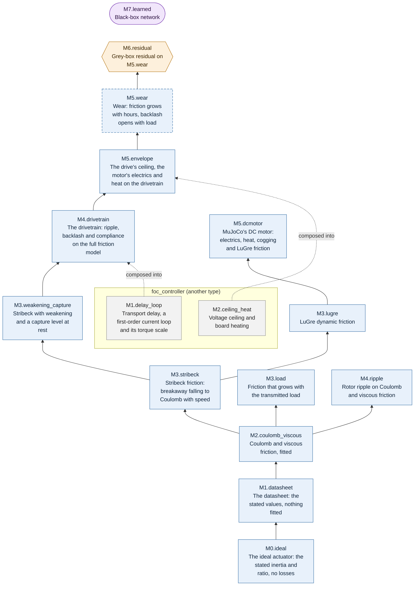

> **Generated file.** Written by [`tools/make_type_docs.py`](../../../../tools/make_type_docs.py) from this folder's [`ladder.py`](ladder.py): edit the ladder, not this file, then run `python tools/make_type_docs.py` from the repository root.

# integrated_servo

A joint in one housing: a motor, its drive, a reducer or none, and an encoder.

**14 rungs** · 52 parameters · 44 aliases · 7 packed names · 6 deployment-only names · folder `actuators/servo/` · datasheet class [`IntegratedServo`](integrated_servo.py), whose typed fields rung `M1.datasheet` states.

In code: `ladders()["integrated_servo"]` from [`robot_models.ladder`](../../ladder.py). Every type: [docs/TYPES.md](../../../../docs/TYPES.md). Spec: [PEP 0004](../../../../docs/peps/0004-model-ladders-by-type.md).
Types in the folders below this one: [`bldc_motor`](bldc/README.md), [`foc_controller`](foc_controller/README.md), [`gearbox`](gearbox/README.md).
Projects the notes below name, and what they are: [Cad2Robot](../../../../docs/TYPES.md#name-cad2robot), [MuJoCo](../../../../docs/TYPES.md#name-mujoco), [robotparts](../../../../docs/TYPES.md#name-robotparts), [sim2real](../../../../docs/TYPES.md#name-sim2real), [the rack twin](../../../../docs/TYPES.md#name-the-rack-twin).

## About

From the docstring of [`ladder.py`](ladder.py):

Spec: PEP 0004 §5.2 and §6.1 (docs/peps/0004-model-ladders-by-type.md).

The ladder climbs the way a joint's torque model grows:

- M0 and M1 state the part (its inertia and ratio, then every datasheet field) and fit nothing.
- M2 to M3 are friction, from Coulomb and viscous through Stribeck, load, LuGre, and weakening with a capture level.
- M4 adds the drivetrain, rotor ripple, backlash and compliance, and composes the drive's own delay loop.
- M5 is the electrics and heat (MuJoCo's DC motor, and the drive's ceiling) and the wear that grows with use.
- M6 is a learned residual on the wear rung and M7 a black-box network.

Torques, speeds and inertias are at the OUTPUT, after the reducer, as `IntegratedServo`'s datasheet states them; kt,
kv and rotor_inertia stay on the rotor. Every name below is a canonical one: sim2real's twin names, the registry's
keys and the exporter's fields are aliases (a unit never appears in a canonical name), and MuJoCo's arrays are packed
names. What a deployment sets (gains, current limit) is `deployment`, never a rung's parameter.

## The ladder

Read it bottom up: each solid arrow runs from a rung's base to the rung that extends it, and a rung needs everything below it on its own chain (its fallback). Blue box: a physics rung; dashed blue box: a wear rung (a parameter that grows with use); amber hexagon: the grey-box residual (M6) on a physics rung; purple rounded box: the learned net (M7), which extends no model; grey box in a frame: another type's rung, its dashed arrow into the rung that composes it.

## Rungs

Bottom up. *Needs* is what the rung's model cannot run without, new over its base; *reads when stated* is what it uses when a source states it. A rung needs everything its base needs.

| rung | title | base | needs (adds) | reads when stated (optional) | code | equation | references |
| --- | --- | --- | --- | --- | --- | --- | --- |
| `M0.ideal` | The ideal actuator: the stated inertia and ratio, no losses | — | `output_inertia`, `gear_ratio` | — | [`actuators/rungs/ideal`](../rungs/ideal/README.md) | `tau_r = 0; armature = output_inertia` | [SICILIANO_2009](#ref-siciliano_2009), [MUJOCO_ARMATURE](#ref-mujoco_armature) |
| `M1.datasheet` | The datasheet: the stated values, nothing fitted *States every IntegratedServo field and needs none beyond M0 (robotparts' M1: required false).* | [`M0.ideal`](#rung-m0-ideal) | — | every `IntegratedServo` typed field its base does not hold: 33 names, each listed under [Vocabulary](#vocabulary) | [`actuators/rungs/datasheet`](../rungs/datasheet/README.md) | `tau_r = coulomb_friction·sign(v) + viscous_friction·v when stated; armature = output_inertia, or gear_ratio²·(rotor_inertia + gearbox_input_inertia)` | [ARMSTRONG_1994](#ref-armstrong_1994), [MUJOCO_ARMATURE](#ref-mujoco_armature) |
| `M2.coulomb_viscous` | Coulomb and viscous friction, fitted | [`M1.datasheet`](#rung-m1-datasheet) | `coulomb_friction`, `viscous_friction` | — | [`actuators/rungs/coulomb_viscous`](../rungs/coulomb_viscous/README.md) | `tau_r = coulomb_friction·sign(v) + viscous_friction·v` | [ARMSTRONG_1994](#ref-armstrong_1994), [OLSSON_1998](#ref-olsson_1998) |
| `M3.stribeck` | Stribeck friction: breakaway falling to Coulomb with speed | [`M2.coulomb_viscous`](#rung-m2-coulomb_viscous) | `breakaway_torque`, `stribeck_velocity` | `stribeck_exponent` | [`actuators/rungs/stribeck`](../rungs/stribeck/README.md) | `tau_r = (coulomb_friction + (breakaway_torque − coulomb_friction)·exp(−(\|v\|/stribeck_velocity)^stribeck_exponent))·sign(v) + viscous_friction·v` | [ARMSTRONG_1994](#ref-armstrong_1994), [OLSSON_1998](#ref-olsson_1998) |
| `M3.load` | Friction that grows with the transmitted load | [`M2.coulomb_viscous`](#rung-m2-coulomb_viscous) | `friction_load_coefficient` | — | [`actuators/rungs/load`](../rungs/load/README.md) | `tau_r = (coulomb_friction + friction_load_coefficient·\|tau_load\|)·sign(v) + viscous_friction·v` | [KIRCANSKI_1997](#ref-kircanski_1997), [OLSSON_1998](#ref-olsson_1998) |
| `M3.lugre` | LuGre dynamic friction | [`M3.stribeck`](#rung-m3-stribeck) | `sigma0`, `sigma1` | — | [`actuators/rungs/lugre`](../rungs/lugre/README.md) | `dz/dt = v − sigma0·\|v\|·z/g(v), g(v) the Stribeck level of M3.stribeck; tau_r = sigma0·z + sigma1·dz/dt + viscous_friction·v (LuGre's sigma2)` | [CANUDAS_1995](#ref-canudas_1995) |
| `M3.weakening_capture` | Stribeck with weakening and a capture level at rest *sim2real's servo M3, the rack twin's friction: its structure only, the twin is never published.* | [`M3.stribeck`](#rung-m3-stribeck) | `friction_weakening`, `friction_weakening_limit`, `friction_capture`, `friction_capture_speed`, `friction_capture_dwell` | — | — | `level(v) = breakaway_torque − friction_weakening·min(\|v\|, friction_weakening_limit) − (breakaway_torque − coulomb_friction)·(1 − exp(−(\|v\|/stribeck_velocity)²)); friction_capture holds below friction_capture_speed until friction_capture_dwell has passed` | [ARMSTRONG_1994](#ref-armstrong_1994), [CANUDAS_1995](#ref-canudas_1995) |
| `M4.ripple` | Rotor ripple on Coulomb and viscous friction | [`M2.coulomb_viscous`](#rung-m2-coulomb_viscous) | `harmonics` | — | [`actuators/rungs/ripple`](../rungs/ripple/README.md) | `tau_r = Σ_k amplitude_k·sin(rotor_harmonic_k·gear_ratio·θ + phase_k) + coulomb_friction·sign(v) + viscous_friction·v` | [JAHNS_1996](#ref-jahns_1996) |
| `M4.drivetrain` | The drivetrain: ripple, backlash and compliance on the full friction model *sim2real's servo M4, the rack twin (today's model), less its heat: that is M5.envelope's.* composes [`foc_controller` `M1.delay_loop`](foc_controller/README.md#rung-m1-delay_loop) | [`M3.weakening_capture`](#rung-m3-weakening_capture) | `harmonics`, `backlash`, `torsional_stiffness` | — | — | `output_inertia·q̈ = tau_drive − tau_r; tau_r = level(v)·sign(v) + viscous_friction·v + the harmonics; the output across a backlash gap and torsional_stiffness; tau_drive from foc_controller M1.delay_loop` | [JAHNS_1996](#ref-jahns_1996), [NORDIN_2002](#ref-nordin_2002), [TUTTLE_1996](#ref-tuttle_1996), [KRISHNAN_2010](#ref-krishnan_2010) |
| `M5.dcmotor` | MuJoCo's DC motor: electrics, heat, cogging and LuGre friction *robotparts' rung: its terms are MuJoCo's arrays (the packed names); motorconst and resistance required, the rest optional, as its model.json marks them.* | [`M3.lugre`](#rung-m3-lugre) | `kt`, `resistance_line_to_line` | `harmonics`, `thermal_resistance`, `thermal_time_constant` | [`actuators/rungs/dcmotor`](../rungs/dcmotor/README.md) | `MuJoCo's own: mjDYN_DCMOTOR (electrical dynamics), mjGAIN_DCMOTOR (K or K/R), mjBIAS_DCMOTOR (back-EMF, cogging, LuGre friction)` | [KRAUSE_2013](#ref-krause_2013), [MUJOCO_DCMOTOR](#ref-mujoco_dcmotor) |
| `M5.envelope` | The drive's ceiling, the motor's electrics and heat on the drivetrain *sim2real's servo M5 (the envelope ladder): the rack twin plus the drive's ceiling and the motor's electrics; the heat the twin carries at its M4 sits here, robotparts' layer 5.* composes [`foc_controller` `M2.ceiling_heat`](foc_controller/README.md#rung-m2-ceiling_heat) | [`M4.drivetrain`](#rung-m4-drivetrain) | `kt`, `resistance_line_to_line`, `thermal_resistance`, `thermal_time_constant` | — | — | `kt_out = kt·gear_ratio, R = resistance_line_to_line/2 per phase: motoring torque ≤ kt_out·(voltage_available − \|v\|·kt_out/1.5)/R; any torque ≤ kt_out·I_max (the deployment's current cap); winding rise ΔT over ambient: thermal_time_constant·dΔT/dt = thermal_resistance·1.5·i²R − ΔT (the three phases' copper loss, i the phase-current amplitude)` | [KRAUSE_2013](#ref-krause_2013), [KRISHNAN_2010](#ref-krishnan_2010), [MUJOCO_DCMOTOR](#ref-mujoco_dcmotor) |
| `M5.wear` | Wear: friction grows with hours, backlash opens with load wears `breakaway_torque`, `coulomb_friction`, `backlash`: see [Wear](#wear) | [`M5.envelope`](#rung-m5-envelope) | `friction_growth`, `backlash_wear` | — | — | `backlash(u) = backlash + backlash_wear·Σ\|τ\|·Δrev; breakaway_torque and coulomb_friction both grow by friction_growth·h (the Stribeck drop stays)` | [ARCHARD_1953](#ref-archard_1953), [FLODIN_1997](#ref-flodin_1997), [LU_MEEKER_1993](#ref-lu_meeker_1993) |
| `M6.residual` | Grey-box residual on M5.wear | [`M5.wear`](#rung-m5-wear) | — | — | — | `M5.wear + an MLP residual torque from 3 samples of position error, velocity and torque command` | [NGUYEN_TUONG_2010](#ref-nguyen_tuong_2010), [ZENG_2020](#ref-zeng_2020), [KOVALEV_2026](#ref-kovalev_2026) |
| `M7.learned` | Black-box network | — | — | — | — | `an MLP over 3 samples of position error and velocity → output torque` | [HWANGBO_2019](#ref-hwangbo_2019), [HWANGBO_2019_ARXIV](#ref-hwangbo_2019_arxiv), [ZHU_2025](#ref-zhu_2025) |

## Wear

Which parameter grows with use, with what, by which law, at which rate.

| rung | parameter that wears | grows with | law | rate |
| --- | --- | --- | --- | --- |
| [`M5.wear`](#rung-m5-wear) | [`breakaway_torque`](#param-breakaway_torque) | deployment hours (h) | linear: `p(u) = p0 + k·u` | [`friction_growth`](#param-friction_growth) |
| [`M5.wear`](#rung-m5-wear) | [`coulomb_friction`](#param-coulomb_friction) | deployment hours (h) | linear: `p(u) = p0 + k·u` | [`friction_growth`](#param-friction_growth) |
| [`M5.wear`](#rung-m5-wear) | [`backlash`](#param-backlash) | torque-weighted output revolutions (N·m·rev) | archard: `p(u) = p0 + k·Σ(load·distance): wear grows with the load carried times the distance slid` | [`backlash_wear`](#param-backlash_wear) |

## Vocabulary

Every parameter the ladder holds, by the rung that first reads it. — as a unit: dimensionless (a ratio or a count).

| parameter | SI unit | shape | definition | first read on |
| --- | --- | --- | --- | --- |
| `gear_ratio` | — | scalar | Rotor turns per output turn, > 0: 10 for a 10:1 reducer. | [`M0.ideal`](#rung-m0-ideal) |
| `output_inertia` | kg·m² | scalar | The part's own inertia about its axis, referred to the output (MuJoCo's armature). | [`M0.ideal`](#rung-m0-ideal) |
| `peak_torque` | N·m | scalar | Peak (stall, max) torque at the output. | [`M1.datasheet`](#rung-m1-datasheet) (when stated) |
| `rated_torque` | N·m | scalar | Continuous (rated) torque at the output. | [`M1.datasheet`](#rung-m1-datasheet) (when stated) |
| `max_output_speed` | rad/s | scalar | No-load (maximum) speed at the output. | [`M1.datasheet`](#rung-m1-datasheet) (when stated) |
| `rated_speed` | rad/s | scalar | Speed at rated torque, at the output. | [`M1.datasheet`](#rung-m1-datasheet) (when stated) |
| `rated_power` | W | scalar | Continuous MECHANICAL output power, rated torque × rated speed; an electrical input power is not this. | [`M1.datasheet`](#rung-m1-datasheet) (when stated) |
| `nominal_voltage` | V | scalar | Nominal supply voltage. | [`M1.datasheet`](#rung-m1-datasheet) (when stated) |
| `voltage_min` | V | scalar | Lowest supply voltage the part is rated for. | [`M1.datasheet`](#rung-m1-datasheet) (when stated) |
| `voltage_max` | V | scalar | Highest supply voltage the part is rated for. | [`M1.datasheet`](#rung-m1-datasheet) (when stated) |
| `rated_phase_current` | A | scalar | Continuous phase current at rated torque (catalogue name). | [`M1.datasheet`](#rung-m1-datasheet) (when stated) |
| `max_phase_current` | A | scalar | Peak phase current, at peak torque (catalogue name). | [`M1.datasheet`](#rung-m1-datasheet) (when stated) |
| `kv` | rad/(s·V) | scalar | Velocity constant: no-load ROTOR speed per volt (line-to-line peak back-EMF). A geared part's source may state it at the output: say at='output'. | [`M1.datasheet`](#rung-m1-datasheet) (when stated) |
| `kt` | N·m/A | scalar | Torque constant: ROTOR torque per ampere of phase-current amplitude. A geared part's source may state it at the output: say at='output'. | [`M1.datasheet`](#rung-m1-datasheet) (when stated); needed from [`M5.dcmotor`](#rung-m5-dcmotor) |
| `back_emf_constant` | V·s/rad | scalar | Line-to-line back-EMF per speed (catalogue name). | [`M1.datasheet`](#rung-m1-datasheet) (when stated) |
| `resistance_line_to_line` | Ω | scalar | Winding resistance between two leads (line to line); a page's 'phase to phase' is this. | [`M1.datasheet`](#rung-m1-datasheet) (when stated); needed from [`M5.dcmotor`](#rung-m5-dcmotor) |
| `inductance_line_to_line` | H | scalar | Winding inductance between two leads (line to line). | [`M1.datasheet`](#rung-m1-datasheet) (when stated) |
| `pole_pairs` | — | integer | Magnetic pole pairs. | [`M1.datasheet`](#rung-m1-datasheet) (when stated) |
| `encoder_lines` | — | integer | Encoder lines (pulses) per rotor turn (catalogue name). | [`M1.datasheet`](#rung-m1-datasheet) (when stated) |
| `encoder_bits` | — | integer | Encoder resolution in bits per rotor turn (catalogue name). | [`M1.datasheet`](#rung-m1-datasheet) (when stated) |
| `mass` | kg | scalar | Mass as sold, without optional accessories. | [`M1.datasheet`](#rung-m1-datasheet) (when stated) |
| `rotor_inertia` | kg·m² | scalar | The rotor's moment of inertia on the INPUT (rotor) side. Read as output-side it is off by gear_ratio²; a source stating the reflected value says at='output'. | [`M1.datasheet`](#rung-m1-datasheet) (when stated) |
| `coulomb_friction` | N·m | scalar | Coulomb friction torque at the output. | [`M1.datasheet`](#rung-m1-datasheet) (when stated); needed from [`M2.coulomb_viscous`](#rung-m2-coulomb_viscous) |
| `viscous_friction` | N·m·s/rad | scalar | Viscous friction coefficient at the output. | [`M1.datasheet`](#rung-m1-datasheet) (when stated); needed from [`M2.coulomb_viscous`](#rung-m2-coulomb_viscous) |
| `torque_ripple` | N·m | scalar | Amplitude of a rotor-periodic torque harmonic at the output (cogging); the note says which harmonic. | [`M1.datasheet`](#rung-m1-datasheet) (when stated) |
| `outer_diameter` | m | scalar | Largest diameter of a round housing. | [`M1.datasheet`](#rung-m1-datasheet) (when stated) |
| `axial_length` | m | scalar | Overall length of a round housing along its axis. | [`M1.datasheet`](#rung-m1-datasheet) (when stated) |
| `flange_size` | m | scalar | Square flange edge (catalogue name). | [`M1.datasheet`](#rung-m1-datasheet) (when stated) |
| `body_length` | m | scalar | Body length behind the flange, without the shaft (catalogue name). | [`M1.datasheet`](#rung-m1-datasheet) (when stated) |
| `shaft_diameter` | m | scalar | Output shaft diameter (catalogue name). | [`M1.datasheet`](#rung-m1-datasheet) (when stated) |
| `backlash` | rad | scalar | Backlash at the output. | [`M1.datasheet`](#rung-m1-datasheet) (when stated); needed from [`M4.drivetrain`](#rung-m4-drivetrain) |
| `efficiency` | — | scalar | Reducer efficiency, power out over power in, at the source's operating point. | [`M1.datasheet`](#rung-m1-datasheet) (when stated) |
| `gearbox_input_inertia` | kg·m² | scalar | The reducer's inertia referred to its input shaft. | [`M1.datasheet`](#rung-m1-datasheet) (when stated) |
| `max_axial_load` | N | scalar | Largest axial load on the output (catalogue name). | [`M1.datasheet`](#rung-m1-datasheet) (when stated) |
| `max_radial_load` | N | scalar | Largest radial load on the output (catalogue name). | [`M1.datasheet`](#rung-m1-datasheet) (when stated) |
| `breakaway_torque` | N·m | scalar | Static friction at the output: the torque that starts it moving from rest, the top of the Stribeck curve. | [`M3.stribeck`](#rung-m3-stribeck) |
| `stribeck_velocity` | rad/s | scalar | Output speed over which friction falls from breakaway_torque to coulomb_friction. | [`M3.stribeck`](#rung-m3-stribeck) |
| `stribeck_exponent` | — | scalar | Shape exponent of the Stribeck curve, how sharply friction falls with speed; 2 when absent. | [`M3.stribeck`](#rung-m3-stribeck) (when stated) |
| `friction_load_coefficient` | — | scalar | Extra output friction per N·m of load torque the part transmits: Fc + μ·abs(τ_load). | [`M3.load`](#rung-m3-load) |
| `sigma0` | N·m/rad | scalar | LuGre bristle stiffness: output torque per radian of bristle deflection. | [`M3.lugre`](#rung-m3-lugre) |
| `sigma1` | N·m·s/rad | scalar | LuGre bristle damping: output torque per rad/s of bristle deflection rate. | [`M3.lugre`](#rung-m3-lugre) |
| `friction_weakening` | N·m·s/rad | scalar | How fast the static friction level falls with output speed, up to friction_weakening_limit. | [`M3.weakening_capture`](#rung-m3-weakening_capture) |
| `friction_weakening_limit` | rad/s | scalar | The output speed up to which the friction level keeps weakening. | [`M3.weakening_capture`](#rung-m3-weakening_capture) |
| `friction_capture` | N·m | scalar | The friction level that holds a slowed output until it has stayed slow for friction_capture_dwell. | [`M3.weakening_capture`](#rung-m3-weakening_capture) |
| `friction_capture_speed` | rad/s | scalar | Below this output speed a joint counts as slow for capture. | [`M3.weakening_capture`](#rung-m3-weakening_capture) |
| `friction_capture_dwell` | s | scalar | How long a joint must stay slow before the static level returns. | [`M3.weakening_capture`](#rung-m3-weakening_capture) |
| `harmonics` | N·m | list | Rotor-periodic torque harmonics at the output, a list of (rotor_harmonic, amplitude, phase): cogging and commutation ripple. | [`M4.ripple`](#rung-m4-ripple) |
| `torsional_stiffness` | N·m/rad | scalar | Drivetrain stiffness at the output with the rotor held: output torque per radian of twist. | [`M4.drivetrain`](#rung-m4-drivetrain) |
| `thermal_resistance` | K/W | scalar | Winding-to-ambient thermal resistance: winding temperature rise per watt of copper loss. | [`M5.dcmotor`](#rung-m5-dcmotor) (when stated); needed from [`M5.envelope`](#rung-m5-envelope) |
| `thermal_time_constant` | s | scalar | Time constant of the winding temperature's first-order rise. | [`M5.dcmotor`](#rung-m5-dcmotor) (when stated); needed from [`M5.envelope`](#rung-m5-envelope) |
| `friction_growth` | N·m/h | scalar | How fast the friction level grows per deployment hour (seals, grease, bearings); on a Stribeck curve breakaway and Coulomb grow together. | [`M5.wear`](#rung-m5-wear) |
| `backlash_wear` | rad/(N·m·rev) | scalar | How fast backlash opens per torque-weighted output revolution (Archard). | [`M5.wear`](#rung-m5-wear) |

## Aliases

Other names a source uses for one of these parameters. A note says how it differs when it is not the same quantity one for one. The unit is the one the source writes its values in; *(canonical)* after it marks an alias stored with no unit of its own, which robot_models reads as the canonical parameter's SI unit, shown here spelled out. A note can still qualify that unit.

| alias | canonical | unit | note |
| --- | --- | --- | --- |
| `armature_kg_m2` | [`output_inertia`](#param-output_inertia) | kg·m² *(canonical)* | As mounted: the whole axis' inertia at the output, the part's own plus what it drives; output_inertia is the part alone. |
| `backlash_arcmin` | [`backlash`](#param-backlash) | arcmin |   |
| `backlash_rad` | [`backlash`](#param-backlash) | rad *(canonical)* |   |
| `backlash_wear_rad_per_nm_rev` | [`backlash_wear`](#param-backlash_wear) | rad/(N·m·rev) *(canonical)* |   |
| `damping_nm_s_rad` | [`viscous_friction`](#param-viscous_friction) | N·m·s/rad *(canonical)* |   |
| `encoder_counts` | [`encoder_lines`](#param-encoder_lines) | dimensionless *(canonical)* | Counts per turn: 4 × lines on a quadrature encoder. |
| `friction_capture_dwell_s` | [`friction_capture_dwell`](#param-friction_capture_dwell) | s *(canonical)* |   |
| `friction_capture_nm` | [`friction_capture`](#param-friction_capture) | N·m *(canonical)* |   |
| `friction_capture_speed_rad_s` | [`friction_capture_speed`](#param-friction_capture_speed) | rad/s *(canonical)* |   |
| `friction_growth_nm_per_h` | [`friction_growth`](#param-friction_growth) | N·m/h *(canonical)* | It grows the rack twin's frictionloss, the static level: breakaway_torque and coulomb_friction together. |
| `friction_stribeck_drop_nm` | [`breakaway_torque`](#param-breakaway_torque) | N·m *(canonical)* | A difference, not a level: breakaway_torque − coulomb_friction. |
| `friction_stribeck_speed_rad_s` | [`stribeck_velocity`](#param-stribeck_velocity) | rad/s *(canonical)* | The twin's Stribeck exponent is fixed at 2. |
| `friction_weakening_limit_rad_s` | [`friction_weakening_limit`](#param-friction_weakening_limit) | rad/s *(canonical)* |   |
| `friction_weakening_nm_s_rad` | [`friction_weakening`](#param-friction_weakening) | N·m·s/rad *(canonical)* |   |
| `frictionloss_nm` | [`coulomb_friction`](#param-coulomb_friction) | N·m *(canonical)* | The rack twin's frictionloss is the static level: with no Stribeck term it is coulomb_friction; with one it is breakaway_torque, and coulomb_friction = frictionloss − friction_stribeck_drop. |
| `gear_stiffness_nm_rad` | [`torsional_stiffness`](#param-torsional_stiffness) | N·m/rad *(canonical)* | Fitted on a mounted unit: it includes the mount's compliance. |
| `kt_out_nm_a` | [`kt`](#param-kt) | N·m/A *(canonical)* | Output side: kt_out = kt × gear_ratio. |
| `length_mm` | [`axial_length`](#param-axial_length) | mm |   |
| `mass_kg` | [`mass`](#param-mass) | kg *(canonical)* |   |
| `max_effort_nm` | [`peak_torque`](#param-peak_torque) | N·m *(canonical)* | Cad2Robot's servo field: the effort limit it exports. |
| `max_speed` | [`max_output_speed`](#param-max_output_speed) | rad/s *(canonical)* | Old user-part key: may be a mechanical limit rather than the no-load speed. |
| `max_velocity_rad_s` | [`max_output_speed`](#param-max_output_speed) | rad/s *(canonical)* | Cad2Robot's servo field: the velocity limit it exports. |
| `noload_speed` | [`max_output_speed`](#param-max_output_speed) | rad/s *(canonical)* | Old user-part key: its unit is the part file's; check it before converting. |
| `noload_speed_rpm` | [`max_output_speed`](#param-max_output_speed) | rpm |   |
| `od_mm` | [`outer_diameter`](#param-outer_diameter) | mm |   |
| `peak_current_a` | [`max_phase_current`](#param-max_phase_current) | A *(canonical)* |   |
| `peak_phase_current` | [`max_phase_current`](#param-max_phase_current) | A *(canonical)* | The registry's driver key: what the integrated drive can deliver; the motor alone may take more. |
| `peak_torque_nm` | [`peak_torque`](#param-peak_torque) | N·m *(canonical)* |   |
| `phase_inductance` | [`inductance_line_to_line`](#param-inductance_line_to_line) | H *(canonical)* | Old user-part key: per phase is half of line to line on a wye winding. |
| `phase_inductance_h` | [`inductance_line_to_line`](#param-inductance_line_to_line) | H | Per phase (Cad2Robot's motor): half of line to line on a wye winding. |
| `phase_resistance` | [`resistance_line_to_line`](#param-resistance_line_to_line) | Ω *(canonical)* | Old user-part key: a 'phase to phase' value is line to line; a per-phase value is half of it on a wye winding. |
| `phase_resistance_ohm` | [`resistance_line_to_line`](#param-resistance_line_to_line) | Ω | Per phase (sim2real's servo, Cad2Robot's motor): line to line is twice it on a wye winding. |
| `rated_current_a` | [`rated_phase_current`](#param-rated_phase_current) | A *(canonical)* |   |
| `rated_power_w` | [`rated_power`](#param-rated_power) | W *(canonical)* |   |
| `rated_speed_rpm` | [`rated_speed`](#param-rated_speed) | rpm |   |
| `rated_torque_nm` | [`rated_torque`](#param-rated_torque) | N·m *(canonical)* |   |
| `resistance` | [`resistance_line_to_line`](#param-resistance_line_to_line) | Ω | M5.dcmotor's winding resistance as MuJoCo takes it, per phase as sim2real reads it (phase_resistance_ohm): line to line is twice it on a wye winding. |
| `ripple_harmonics` | [`harmonics`](#param-harmonics) | N·m *(canonical)* |   |
| `ripple_rotor_per_output` | [`gear_ratio`](#param-gear_ratio) | dimensionless *(canonical)* | The ripple's rotor turns per output turn: the gear ratio as the twin's ripple reads it. |
| `rotor_inertia_kg_m2` | [`rotor_inertia`](#param-rotor_inertia) | kg·m² *(canonical)* |   |
| `sigma2` | [`viscous_friction`](#param-viscous_friction) | N·m·s/rad *(canonical)* | LuGre's own symbol (M3.lugre) for the same viscous coefficient. |
| `torque_coefficient` | [`kt`](#param-kt) | N·m/A *(canonical)* | Catalogue part key: check RMS against peak amperes (kt is per peak ampere). |
| `torque_constant` | [`kt`](#param-kt) | N·m/A *(canonical)* | Old user-part key: a geared part's source may state it at the output (kt × gear_ratio). |
| `voltage_v` | [`nominal_voltage`](#param-nominal_voltage) | V *(canonical)* |   |

## Packed names

Names for one array that carries several of these parameters; never read as one parameter.

| packed name | carries | order | note |
| --- | --- | --- | --- |
| `cogging` | [`harmonics`](#param-harmonics) | at least these; entry order not stated | M5.dcmotor's MuJoCo array (unit mujoco), 3 numbers: one cogging harmonic (harmonic, amplitude, phase) in MuJoCo's order, unverified here. |
| `inductance` | [`inductance_line_to_line`](#param-inductance_line_to_line) | at least these; entry order not stated | M5.dcmotor's MuJoCo array (unit mujoco), 2 numbers; per phase or line to line is MuJoCo's convention, unverified here. |
| `lugre` | [`sigma0`](#param-sigma0), [`sigma1`](#param-sigma1) | at least these; entry order not stated | M5.dcmotor's MuJoCo array (unit mujoco), 5 numbers: the M3.lugre terms in MuJoCo's order, unverified here. |
| `motorconst` | [`kt`](#param-kt) | at least these; entry order not stated | M5.dcmotor's MuJoCo array (unit mujoco), 2 numbers: sim2real reads the torque constant from it at the OUTPUT (kt × gear_ratio, unless the actuator's gear carries the ratio); the other entry is MuJoCo's, unverified here. |
| `nominal` | [`nominal_voltage`](#param-nominal_voltage) | at least these; entry order not stated | M5.dcmotor's MuJoCo array (unit mujoco), 3 numbers of nominal ratings; the other entries are MuJoCo's, unverified here. |
| `thermal` | [`thermal_resistance`](#param-thermal_resistance), [`thermal_time_constant`](#param-thermal_time_constant) | at least these; entry order not stated | M5.dcmotor's MuJoCo array (unit mujoco), 6 numbers; the rest and the order are MuJoCo's, unverified here. |
| `thermal_r_c` | [`thermal_resistance`](#param-thermal_resistance), [`thermal_time_constant`](#param-thermal_time_constant) | its full entry order | The rack twin's (K/W, s) pair. Its thermal model fits a Foster network of one or two poles; with two, thermal_resistance = ΣR_k and no single time constant holds. |

## Deployment-only names

Names some model reads that are not the type's own: a deployment sets them, or the mount gives them.

- *assembly*: a property of where the part is mounted (the station's gravity, a base frame): the description's.
- *config*: a setting a deployment writes (a gain, a cap, a rate): read from its config, never fitted to the type.

| name | role | where it belongs |
| --- | --- | --- |
| `controller` | config | M5.dcmotor's MuJoCo controller array: the drive's control settings. |
| `gravity_nm` | assembly | The station's gravity torque on the joint: the description's. |
| `kd_nm_s_rad` | config | The drive's velocity gain: the deployment's config. |
| `kp_nm_rad` | config | The drive's position gain: the deployment's config. |
| `max_current_a` | config | The drive's current limit: the deployment's config. |
| `saturation` | config | M5.dcmotor's MuJoCo saturation array: the drive's ceilings. |

## References

The works the rungs cite, by their names in [`robot_models.references`](../../references.py).

- **ARCHARD_1953**: Archard (1953). Contact and rubbing of flat surfaces. Journal of Applied Physics. [doi:10.1063/1.1721448](https://doi.org/10.1063/1.1721448). What the rung uses: wear volume grows with the load carried times the distance slid. Cited by [`M5.wear`](#rung-m5-wear).
- **ARMSTRONG_1994**: Armstrong-Hélouvry, Dupont, Canudas de Wit (1994). A survey of models, analysis tools and compensation methods for the control of machines with friction. Automatica. [doi:10.1016/0005-1098(94)90209-7](https://doi.org/10.1016/0005-1098%2894%2990209-7). What the rung uses: Coulomb, viscous and Stribeck friction. Cited by [`M1.datasheet`](#rung-m1-datasheet), [`M2.coulomb_viscous`](#rung-m2-coulomb_viscous), [`M3.stribeck`](#rung-m3-stribeck), [`M3.weakening_capture`](#rung-m3-weakening_capture).
- **CANUDAS_1995**: Canudas de Wit, Olsson, Åström, Lischinsky (1995). A new model for control of systems with friction. IEEE Transactions on Automatic Control. [doi:10.1109/9.376053](https://doi.org/10.1109/9.376053). What the rung uses: LuGre: the dynamic friction model robotparts' M3.lugre is. Cited by [`M3.lugre`](#rung-m3-lugre), [`M3.weakening_capture`](#rung-m3-weakening_capture).
- **FLODIN_1997**: Flodin, Andersson (1997). Simulation of mild wear in spur gears. Wear. [doi:10.1016/S0043-1648(96)07467-4](https://doi.org/10.1016/S0043-1648%2896%2907467-4). What the rung uses: Archard's law on gear teeth: the flank wear that opens backlash. Cited by [`M5.wear`](#rung-m5-wear).
- **HWANGBO_2019**: Hwangbo, Lee, Dosovitskiy, Bellicoso, Tsounis, Koltun, Hutter (2019). Learning agile and dynamic motor skills for legged robots. Science Robotics. [doi:10.1126/scirobotics.aau5872](https://doi.org/10.1126/scirobotics.aau5872). What the rung uses: ANYmal's actuator net: an MLP over position error and velocity at t, t − 10 ms, t − 20 ms, 3 × 32 softsign (arXiv:1901.08652). Cited by [`M7.learned`](#rung-m7-learned).
- **HWANGBO_2019_ARXIV**: Hwangbo, Lee, Dosovitskiy, Bellicoso, Tsounis, Koltun, Hutter (2019). Learning agile and dynamic motor skills for legged robots. arXiv:1901.08652. [https://arxiv.org/abs/1901.08652](https://arxiv.org/abs/1901.08652) (preprint). What the rung uses: the open version. Cited by [`M7.learned`](#rung-m7-learned).
- **JAHNS_1996**: Jahns, Soong (1996). Pulsating torque minimization techniques for permanent magnet AC motor drives—a review. IEEE Transactions on Industrial Electronics. [doi:10.1109/41.491356](https://doi.org/10.1109/41.491356). What the rung uses: cogging and commutation ripple as rotor harmonics. Cited by [`M4.ripple`](#rung-m4-ripple), [`M4.drivetrain`](#rung-m4-drivetrain).
- **KIRCANSKI_1997**: Kircanski, Goldenberg (1997). An experimental study of nonlinear stiffness, hysteresis, and friction effects in robot joints with harmonic drives and torque sensors. The International Journal of Robotics Research. [doi:10.1177/027836499701600207](https://doi.org/10.1177/027836499701600207). What the rung uses: load-dependent friction and torsional stiffness measured in a joint. Cited by [`M3.load`](#rung-m3-load).
- **KOVALEV_2026**: Kovalev, Chaikovskaia, Davydenko, Gorbachev et al. (2026). Trajectory-based actuator identification via differentiable simulation. arXiv:2604.10351. [https://arxiv.org/abs/2604.10351](https://arxiv.org/abs/2604.10351) (preprint). What the rung uses: a structured servo fit vs an MLP vs a residual model on held-out position error. Cited by [`M6.residual`](#rung-m6-residual).
- **KRAUSE_2013**: Krause, Wasynczuk, Sudhoff, Pekarek (2013). Analysis of Electric Machinery and Drive Systems, 3rd ed. Wiley-IEEE Press. [doi:10.1002/9781118524336](https://doi.org/10.1002/9781118524336) (book). What the rung uses: the PM machine's electrical model: R, L, back-EMF, the voltage ceiling. Cited by [`M5.dcmotor`](#rung-m5-dcmotor), [`M5.envelope`](#rung-m5-envelope).
- **KRISHNAN_2010**: Krishnan (2010). Permanent Magnet Synchronous and Brushless DC Motor Drives. CRC Press. [doi:10.1201/9781420014235](https://doi.org/10.1201/9781420014235) (book). What the rung uses: field-oriented current loops of PM drives. Cited by [`M4.drivetrain`](#rung-m4-drivetrain), [`M5.envelope`](#rung-m5-envelope).
- **LU_MEEKER_1993**: Lu, Meeker (1993). Using degradation measures to estimate a time-to-failure distribution. Technometrics. [doi:10.1080/00401706.1993.10485038](https://doi.org/10.1080/00401706.1993.10485038). What the rung uses: a degradation path in usage, linear the simplest, crossing a failure threshold. Cited by [`M5.wear`](#rung-m5-wear).
- **MUJOCO_ARMATURE**: MuJoCo (2026). XML reference: joint armature. [https://mujoco.readthedocs.io/en/stable/XMLreference.html#body-joint-armature](https://mujoco.readthedocs.io/en/stable/XMLreference.html#body-joint-armature) (doc). What the rung uses: the rotor's inertia reflected through the gear, as the simulator takes it. Cited by [`M0.ideal`](#rung-m0-ideal), [`M1.datasheet`](#rung-m1-datasheet).
- **MUJOCO_DCMOTOR**: MuJoCo (2026). XML reference: the dcmotor actuator. [https://mujoco.readthedocs.io/en/stable/XMLreference.html#actuator-dcmotor](https://mujoco.readthedocs.io/en/stable/XMLreference.html#actuator-dcmotor) (doc). What the rung uses: robotparts' M5.dcmotor: electrics, heat, cogging and LuGre as MuJoCo takes them. Cited by [`M5.dcmotor`](#rung-m5-dcmotor), [`M5.envelope`](#rung-m5-envelope).
- **NGUYEN_TUONG_2010**: Nguyen-Tuong, Peters (2010). Using model knowledge for learning inverse dynamics. IEEE International Conference on Robotics and Automation. [doi:10.1109/ROBOT.2010.5509858](https://doi.org/10.1109/ROBOT.2010.5509858). What the rung uses: a physics model plus a learned residual. Cited by [`M6.residual`](#rung-m6-residual).
- **NORDIN_2002**: Nordin, Gutman (2002). Controlling mechanical systems with backlash—a survey. Automatica. [doi:10.1016/S0005-1098(02)00047-X](https://doi.org/10.1016/S0005-1098%2802%2900047-X). What the rung uses: dead-zone backlash between motor and load. Cited by [`M4.drivetrain`](#rung-m4-drivetrain).
- **OLSSON_1998**: Olsson, Åström, Canudas de Wit, Gäfvert, Lischinsky (1998). Friction models and friction compensation. European Journal of Control. [doi:10.1016/S0947-3580(98)70113-X](https://doi.org/10.1016/S0947-3580%2898%2970113-X). What the rung uses: static friction models from Coulomb + viscous to Stribeck. Cited by [`M2.coulomb_viscous`](#rung-m2-coulomb_viscous), [`M3.stribeck`](#rung-m3-stribeck), [`M3.load`](#rung-m3-load).
- **SICILIANO_2009**: Siciliano, Sciavicco, Villani, Oriolo (2009). Robotics: Modelling, Planning and Control. Springer. [doi:10.1007/978-1-84628-642-1](https://doi.org/10.1007/978-1-84628-642-1) (book). What the rung uses: rigid-body joint dynamics and reflected inertia. Cited by [`M0.ideal`](#rung-m0-ideal).
- **TUTTLE_1996**: Tuttle, Seering (1996). A nonlinear model of a harmonic drive gear transmission. IEEE Transactions on Robotics and Automation. [doi:10.1109/70.499819](https://doi.org/10.1109/70.499819). What the rung uses: a gear's compliance, friction and kinematic error. Cited by [`M4.drivetrain`](#rung-m4-drivetrain).
- **ZENG_2020**: Zeng, Song, Lee, Rodriguez, Funkhouser (2020). TossingBot: learning to throw arbitrary objects with residual physics. IEEE Transactions on Robotics. [doi:10.1109/TRO.2020.2988642](https://doi.org/10.1109/TRO.2020.2988642). What the rung uses: residual physics: learn what the physics estimate misses. Cited by [`M6.residual`](#rung-m6-residual).
- **ZHU_2025**: Zhu, Tanaka, Rafeedi, Hong (2025). Cycloidal quasi-direct drive actuator designs with learning-based torque estimation for legged robotics. arXiv:2410.16591. [https://arxiv.org/abs/2410.16591](https://arxiv.org/abs/2410.16591) (preprint). What the rung uses: a longer history (a 30-step GRU) when ripple or backlash matter. Cited by [`M7.learned`](#rung-m7-learned).
