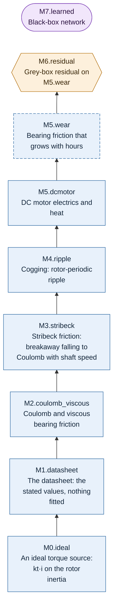

> **Generated file.** Written by [`tools/make_type_docs.py`](../../../../../tools/make_type_docs.py) from this folder's [`ladder.py`](ladder.py): edit the ladder, not this file, then run `python tools/make_type_docs.py` from the repository root.

# bldc_motor

A brushless motor alone, at its shaft.

**9 rungs** · 35 parameters · 27 aliases · 1 packed names · 0 deployment-only names · folder `actuators/servo/bldc/` · datasheet class [`BldcMotor`](bldc_motor.py), whose typed fields rung `M1.datasheet` states.

In code: `ladders()["bldc_motor"]` from [`robot_models.ladder`](../../../ladder.py). Every type: [docs/TYPES.md](../../../../../docs/TYPES.md). Spec: [PEP 0004](../../../../../docs/peps/0004-model-ladders-by-type.md).
Projects the notes below name, and what they are: [Cad2Robot](../../../../../docs/TYPES.md#name-cad2robot), [MuJoCo](../../../../../docs/TYPES.md#name-mujoco), [robotparts](../../../../../docs/TYPES.md#name-robotparts), [sim2real](../../../../../docs/TYPES.md#name-sim2real).

## About

From the docstring of [`ladder.py`](ladder.py):

Rung M1 states every `BldcMotor` field; the fitted rungs above it are sim2real's `motor` card, moved here, with a
Stribeck rung (M3: breakaway falling to Coulomb with shaft speed) between its bearing friction (M2) and its cogging
(M4). A bare motor has no reducer, so the output the ladder speaks of is the rotor itself, its shaft, and robotparts'
actuator rungs (M0 to M5) read as 1:1 actuators on it.

Spec: PEP 0004 §5.3 and §6.2.

## The ladder

Read it bottom up: each solid arrow runs from a rung's base to the rung that extends it, and a rung needs everything below it on its own chain (its fallback). Blue box: a physics rung; dashed blue box: a wear rung (a parameter that grows with use); amber hexagon: the grey-box residual (M6) on a physics rung; purple rounded box: the learned net (M7), which extends no model.

## Rungs

Bottom up. *Needs* is what the rung's model cannot run without, new over its base; *reads when stated* is what it uses when a source states it. A rung needs everything its base needs.

| rung | title | base | needs (adds) | reads when stated (optional) | code | equation | references |
| --- | --- | --- | --- | --- | --- | --- | --- |
| `M0.ideal` | An ideal torque source: kt·i on the rotor inertia *robotparts' M0.ideal read as a 1:1 actuator, whose output is the rotor.* | — | `kt`, `rotor_inertia` | — | — | `τ = kt·i; rotor_inertia·ω̇ = τ − τ_load` | [SICILIANO_2009](#ref-siciliano_2009), [KRAUSE_2013](#ref-krause_2013) |
| `M1.datasheet` | The datasheet: the stated values, nothing fitted | [`M0.ideal`](#rung-m0-ideal) | — | every `BldcMotor` typed field its base does not hold: 26 names, each listed under [Vocabulary](#vocabulary) | — | `τ = kt·i on rotor_inertia, less coulomb_friction·sign(ω) + viscous_friction·ω when stated` | [KRAUSE_2013](#ref-krause_2013), [ARMSTRONG_1994](#ref-armstrong_1994) |
| `M2.coulomb_viscous` | Coulomb and viscous bearing friction *the actuator's M2 on a bare motor: robotparts' actuator rungs cover its category, and its coverage ruler asks a BLDC motor's M2 for both.* | [`M1.datasheet`](#rung-m1-datasheet) | `coulomb_friction`, `viscous_friction` | — | — | `τ_r = coulomb_friction·sign(ω) + viscous_friction·ω` | [ARMSTRONG_1994](#ref-armstrong_1994), [OLSSON_1998](#ref-olsson_1998) |
| `M3.stribeck` | Stribeck friction: breakaway falling to Coulomb with shaft speed *the actuator's M3.stribeck on a bare motor, whose output is the shaft: robotparts' coverage ruler asks a BLDC motor's M3 for both.* | [`M2.coulomb_viscous`](#rung-m2-coulomb_viscous) | `breakaway_torque`, `stribeck_velocity` | `stribeck_exponent` | — | `τ_r = (coulomb_friction + (breakaway_torque − coulomb_friction)·exp(−(\|ω\|/stribeck_velocity)^stribeck_exponent))·sign(ω) + viscous_friction·ω` | [ARMSTRONG_1994](#ref-armstrong_1994), [OLSSON_1998](#ref-olsson_1998) |
| `M4.ripple` | Cogging: rotor-periodic ripple *sim2real's motor M4; a datasheet's torque_ripple states one amplitude of it.* | [`M3.stribeck`](#rung-m3-stribeck) | `harmonics` | — | — | `τ = kt·i − Σ_k amplitude_k·sin(k·θ + phase_k)` | [JAHNS_1996](#ref-jahns_1996) |
| `M5.dcmotor` | DC motor electrics and heat *sim2real's motor M5 (today's model): the actuator's M5 on a bare motor, without LuGre friction.* | [`M4.ripple`](#rung-m4-ripple) | `resistance_line_to_line`, `inductance_line_to_line`, `thermal_resistance`, `thermal_time_constant` | — | — | `τ = kt·i, i the phase-current amplitude; per phase on a wye winding: V = (resistance_line_to_line/2)·i + (inductance_line_to_line/2)·di/dt + (kt/1.5)·ω, the per-phase EMF amplitude; thermal_time_constant·dΔT/dt = thermal_resistance·(3/4)·resistance_line_to_line·i² − ΔT, ΔT the winding's rise over ambient (the three phases' copper loss)` | [KRAUSE_2013](#ref-krause_2013), [KRISHNAN_2010](#ref-krishnan_2010), [MUJOCO_DCMOTOR](#ref-mujoco_dcmotor) |
| `M5.wear` | Bearing friction that grows with hours wears `breakaway_torque`, `coulomb_friction`: see [Wear](#wear) | [`M5.dcmotor`](#rung-m5-dcmotor) | `friction_growth` | — | — | `breakaway_torque and coulomb_friction both grow by friction_growth·h (the Stribeck drop stays)` | [LU_MEEKER_1993](#ref-lu_meeker_1993), [ARMSTRONG_1994](#ref-armstrong_1994) |
| `M6.residual` | Grey-box residual on M5.wear | [`M5.wear`](#rung-m5-wear) | — | — | — | `M5.wear + an MLP residual shaft torque from 3 samples of q-axis current, rotor speed and winding temperature` | [NGUYEN_TUONG_2010](#ref-nguyen_tuong_2010), [ZENG_2020](#ref-zeng_2020) |
| `M7.learned` | Black-box network | — | — | — | — | `an MLP over 3 samples of q-axis current command and rotor speed → shaft torque` | [HWANGBO_2019](#ref-hwangbo_2019), [HWANGBO_2019_ARXIV](#ref-hwangbo_2019_arxiv) |

## Wear

Which parameter grows with use, with what, by which law, at which rate.

| rung | parameter that wears | grows with | law | rate |
| --- | --- | --- | --- | --- |
| [`M5.wear`](#rung-m5-wear) | [`breakaway_torque`](#param-breakaway_torque) | deployment hours (h) | linear: `p(u) = p0 + k·u` | [`friction_growth`](#param-friction_growth) |
| [`M5.wear`](#rung-m5-wear) | [`coulomb_friction`](#param-coulomb_friction) | deployment hours (h) | linear: `p(u) = p0 + k·u` | [`friction_growth`](#param-friction_growth) |

## Vocabulary

Every parameter the ladder holds, by the rung that first reads it. — as a unit: dimensionless (a ratio or a count).

| parameter | SI unit | shape | definition | first read on |
| --- | --- | --- | --- | --- |
| `kt` | N·m/A | scalar | Torque constant: ROTOR torque per ampere of phase-current amplitude. A geared part's source may state it at the output: say at='output'. | [`M0.ideal`](#rung-m0-ideal) |
| `rotor_inertia` | kg·m² | scalar | The rotor's moment of inertia on the INPUT (rotor) side. Read as output-side it is off by gear_ratio²; a source stating the reflected value says at='output'. | [`M0.ideal`](#rung-m0-ideal) |
| `peak_torque` | N·m | scalar | Peak (stall, max) torque at the output. | [`M1.datasheet`](#rung-m1-datasheet) (when stated) |
| `rated_torque` | N·m | scalar | Continuous (rated) torque at the output. | [`M1.datasheet`](#rung-m1-datasheet) (when stated) |
| `max_output_speed` | rad/s | scalar | No-load (maximum) speed at the output. | [`M1.datasheet`](#rung-m1-datasheet) (when stated) |
| `rated_speed` | rad/s | scalar | Speed at rated torque, at the output. | [`M1.datasheet`](#rung-m1-datasheet) (when stated) |
| `rated_power` | W | scalar | Continuous MECHANICAL output power, rated torque × rated speed; an electrical input power is not this. | [`M1.datasheet`](#rung-m1-datasheet) (when stated) |
| `nominal_voltage` | V | scalar | Nominal supply voltage. | [`M1.datasheet`](#rung-m1-datasheet) (when stated) |
| `voltage_min` | V | scalar | Lowest supply voltage the part is rated for. | [`M1.datasheet`](#rung-m1-datasheet) (when stated) |
| `voltage_max` | V | scalar | Highest supply voltage the part is rated for. | [`M1.datasheet`](#rung-m1-datasheet) (when stated) |
| `rated_phase_current` | A | scalar | Continuous phase current at rated torque (catalogue name). | [`M1.datasheet`](#rung-m1-datasheet) (when stated) |
| `max_phase_current` | A | scalar | Peak phase current, at peak torque (catalogue name). | [`M1.datasheet`](#rung-m1-datasheet) (when stated) |
| `kv` | rad/(s·V) | scalar | Velocity constant: no-load ROTOR speed per volt (line-to-line peak back-EMF). A geared part's source may state it at the output: say at='output'. | [`M1.datasheet`](#rung-m1-datasheet) (when stated) |
| `back_emf_constant` | V·s/rad | scalar | Line-to-line back-EMF per speed (catalogue name). | [`M1.datasheet`](#rung-m1-datasheet) (when stated) |
| `pole_pairs` | — | integer | Magnetic pole pairs. | [`M1.datasheet`](#rung-m1-datasheet) (when stated) |
| `encoder_lines` | — | integer | Encoder lines (pulses) per rotor turn (catalogue name). | [`M1.datasheet`](#rung-m1-datasheet) (when stated) |
| `encoder_bits` | — | integer | Encoder resolution in bits per rotor turn (catalogue name). | [`M1.datasheet`](#rung-m1-datasheet) (when stated) |
| `mass` | kg | scalar | Mass as sold, without optional accessories. | [`M1.datasheet`](#rung-m1-datasheet) (when stated) |
| `torque_ripple` | N·m | scalar | Amplitude of a rotor-periodic torque harmonic at the output (cogging); the note says which harmonic. | [`M1.datasheet`](#rung-m1-datasheet) (when stated) |
| `outer_diameter` | m | scalar | Largest diameter of a round housing. | [`M1.datasheet`](#rung-m1-datasheet) (when stated) |
| `axial_length` | m | scalar | Overall length of a round housing along its axis. | [`M1.datasheet`](#rung-m1-datasheet) (when stated) |
| `flange_size` | m | scalar | Square flange edge (catalogue name). | [`M1.datasheet`](#rung-m1-datasheet) (when stated) |
| `body_length` | m | scalar | Body length behind the flange, without the shaft (catalogue name). | [`M1.datasheet`](#rung-m1-datasheet) (when stated) |
| `shaft_diameter` | m | scalar | Output shaft diameter (catalogue name). | [`M1.datasheet`](#rung-m1-datasheet) (when stated) |
| `coulomb_friction` | N·m | scalar | Coulomb friction torque at the output. | [`M1.datasheet`](#rung-m1-datasheet) (when stated); needed from [`M2.coulomb_viscous`](#rung-m2-coulomb_viscous) |
| `viscous_friction` | N·m·s/rad | scalar | Viscous friction coefficient at the output. | [`M1.datasheet`](#rung-m1-datasheet) (when stated); needed from [`M2.coulomb_viscous`](#rung-m2-coulomb_viscous) |
| `resistance_line_to_line` | Ω | scalar | Winding resistance between two leads (line to line); a page's 'phase to phase' is this. | [`M1.datasheet`](#rung-m1-datasheet) (when stated); needed from [`M5.dcmotor`](#rung-m5-dcmotor) |
| `inductance_line_to_line` | H | scalar | Winding inductance between two leads (line to line). | [`M1.datasheet`](#rung-m1-datasheet) (when stated); needed from [`M5.dcmotor`](#rung-m5-dcmotor) |
| `breakaway_torque` | N·m | scalar | Static friction at the output: the torque that starts it moving from rest, the top of the Stribeck curve. | [`M3.stribeck`](#rung-m3-stribeck) |
| `stribeck_velocity` | rad/s | scalar | Output speed over which friction falls from breakaway_torque to coulomb_friction. | [`M3.stribeck`](#rung-m3-stribeck) |
| `stribeck_exponent` | — | scalar | Shape exponent of the Stribeck curve, how sharply friction falls with speed; 2 when absent. | [`M3.stribeck`](#rung-m3-stribeck) (when stated) |
| `harmonics` | N·m | list | Rotor-periodic torque harmonics at the output, a list of (rotor_harmonic, amplitude, phase): cogging and commutation ripple. | [`M4.ripple`](#rung-m4-ripple) |
| `thermal_resistance` | K/W | scalar | Winding-to-ambient thermal resistance: winding temperature rise per watt of copper loss. | [`M5.dcmotor`](#rung-m5-dcmotor) |
| `thermal_time_constant` | s | scalar | Time constant of the winding temperature's first-order rise. | [`M5.dcmotor`](#rung-m5-dcmotor) |
| `friction_growth` | N·m/h | scalar | How fast the friction level grows per deployment hour (seals, grease, bearings); on a Stribeck curve breakaway and Coulomb grow together. | [`M5.wear`](#rung-m5-wear) |

## Aliases

Other names a source uses for one of these parameters. A note says how it differs when it is not the same quantity one for one. The unit is the one the source writes its values in; *(canonical)* after it marks an alias stored with no unit of its own, which robot_models reads as the canonical parameter's SI unit, shown here spelled out. A note can still qualify that unit.

| alias | canonical | unit | note |
| --- | --- | --- | --- |
| `bearing_friction_growth_nm_per_h` | [`friction_growth`](#param-friction_growth) | N·m/h *(canonical)* |   |
| `bearing_friction_nm` | [`coulomb_friction`](#param-coulomb_friction) | N·m *(canonical)* | A bare motor's Coulomb friction is its bearings'. |
| `cogging` | [`torque_ripple`](#param-torque_ripple) | N·m *(canonical)* | sim2real's motor card: one cogging amplitude; its harmonic is not stated. |
| `encoder_counts` | [`encoder_lines`](#param-encoder_lines) | dimensionless *(canonical)* | Counts per turn: 4 × lines on a quadrature encoder. |
| `inductance` | [`inductance_line_to_line`](#param-inductance_line_to_line) | H | sim2real's motor card: the convention as for resistance. |
| `length_mm` | [`axial_length`](#param-axial_length) | mm |   |
| `mass_kg` | [`mass`](#param-mass) | kg *(canonical)* |   |
| `max_speed` | [`max_output_speed`](#param-max_output_speed) | rad/s *(canonical)* | Old user-part key: may be a mechanical limit rather than the no-load speed. |
| `motorconst` | [`kt`](#param-kt) | N·m/A *(canonical)* | sim2real's motor card: the scalar kt, rotor side (robotparts' dcmotor packs an array under this name). |
| `noload_speed` | [`max_output_speed`](#param-max_output_speed) | rad/s *(canonical)* | Old user-part key: its unit is the part file's; check it before converting. |
| `noload_speed_rpm` | [`max_output_speed`](#param-max_output_speed) | rpm |   |
| `od_mm` | [`outer_diameter`](#param-outer_diameter) | mm |   |
| `peak_current_a` | [`max_phase_current`](#param-max_phase_current) | A *(canonical)* |   |
| `peak_torque_nm` | [`peak_torque`](#param-peak_torque) | N·m *(canonical)* |   |
| `phase_inductance` | [`inductance_line_to_line`](#param-inductance_line_to_line) | H *(canonical)* | Old user-part key: per phase is half of line to line on a wye winding. |
| `phase_inductance_h` | [`inductance_line_to_line`](#param-inductance_line_to_line) | H | Per phase (Cad2Robot's motor): half of line to line on a wye winding. |
| `phase_resistance` | [`resistance_line_to_line`](#param-resistance_line_to_line) | Ω *(canonical)* | Old user-part key: a 'phase to phase' value is line to line; a per-phase value is half of it on a wye winding. |
| `phase_resistance_ohm` | [`resistance_line_to_line`](#param-resistance_line_to_line) | Ω | Per phase (sim2real's servo, Cad2Robot's motor): line to line is twice it on a wye winding. |
| `rated_current_a` | [`rated_phase_current`](#param-rated_phase_current) | A *(canonical)* |   |
| `rated_power_w` | [`rated_power`](#param-rated_power) | W *(canonical)* |   |
| `rated_speed_rpm` | [`rated_speed`](#param-rated_speed) | rpm |   |
| `rated_torque_nm` | [`rated_torque`](#param-rated_torque) | N·m *(canonical)* |   |
| `resistance` | [`resistance_line_to_line`](#param-resistance_line_to_line) | Ω | sim2real's motor card, after robotparts' dcmotor: per phase or line to line is not stated; check it before converting. |
| `rotor_inertia_kg_m2` | [`rotor_inertia`](#param-rotor_inertia) | kg·m² *(canonical)* |   |
| `torque_coefficient` | [`kt`](#param-kt) | N·m/A *(canonical)* | Catalogue part key: check RMS against peak amperes (kt is per peak ampere). |
| `torque_constant` | [`kt`](#param-kt) | N·m/A *(canonical)* | Old user-part key: a geared part's source may state it at the output (kt × gear_ratio). |
| `voltage_v` | [`nominal_voltage`](#param-nominal_voltage) | V *(canonical)* |   |

## Packed names

Names for one array that carries several of these parameters; never read as one parameter.

| packed name | carries | order | note |
| --- | --- | --- | --- |
| `thermal` | [`thermal_resistance`](#param-thermal_resistance), [`thermal_time_constant`](#param-thermal_time_constant) | its full entry order | sim2real's motor card: (K/W, s). |

## Deployment-only names

Names some model reads that are not the type's own: a deployment sets them, or the mount gives them.

None.

## References

The works the rungs cite, by their names in [`robot_models.references`](../../../references.py).

- **ARMSTRONG_1994**: Armstrong-Hélouvry, Dupont, Canudas de Wit (1994). A survey of models, analysis tools and compensation methods for the control of machines with friction. Automatica. [doi:10.1016/0005-1098(94)90209-7](https://doi.org/10.1016/0005-1098%2894%2990209-7). What the rung uses: Coulomb, viscous and Stribeck friction. Cited by [`M1.datasheet`](#rung-m1-datasheet), [`M2.coulomb_viscous`](#rung-m2-coulomb_viscous), [`M3.stribeck`](#rung-m3-stribeck), [`M5.wear`](#rung-m5-wear).
- **HWANGBO_2019**: Hwangbo, Lee, Dosovitskiy, Bellicoso, Tsounis, Koltun, Hutter (2019). Learning agile and dynamic motor skills for legged robots. Science Robotics. [doi:10.1126/scirobotics.aau5872](https://doi.org/10.1126/scirobotics.aau5872). What the rung uses: ANYmal's actuator net: an MLP over position error and velocity at t, t − 10 ms, t − 20 ms, 3 × 32 softsign (arXiv:1901.08652). Cited by [`M7.learned`](#rung-m7-learned).
- **HWANGBO_2019_ARXIV**: Hwangbo, Lee, Dosovitskiy, Bellicoso, Tsounis, Koltun, Hutter (2019). Learning agile and dynamic motor skills for legged robots. arXiv:1901.08652. [https://arxiv.org/abs/1901.08652](https://arxiv.org/abs/1901.08652) (preprint). What the rung uses: the open version. Cited by [`M7.learned`](#rung-m7-learned).
- **JAHNS_1996**: Jahns, Soong (1996). Pulsating torque minimization techniques for permanent magnet AC motor drives—a review. IEEE Transactions on Industrial Electronics. [doi:10.1109/41.491356](https://doi.org/10.1109/41.491356). What the rung uses: cogging and commutation ripple as rotor harmonics. Cited by [`M4.ripple`](#rung-m4-ripple).
- **KRAUSE_2013**: Krause, Wasynczuk, Sudhoff, Pekarek (2013). Analysis of Electric Machinery and Drive Systems, 3rd ed. Wiley-IEEE Press. [doi:10.1002/9781118524336](https://doi.org/10.1002/9781118524336) (book). What the rung uses: the PM machine's electrical model: R, L, back-EMF, the voltage ceiling. Cited by [`M0.ideal`](#rung-m0-ideal), [`M1.datasheet`](#rung-m1-datasheet), [`M5.dcmotor`](#rung-m5-dcmotor).
- **KRISHNAN_2010**: Krishnan (2010). Permanent Magnet Synchronous and Brushless DC Motor Drives. CRC Press. [doi:10.1201/9781420014235](https://doi.org/10.1201/9781420014235) (book). What the rung uses: field-oriented current loops of PM drives. Cited by [`M5.dcmotor`](#rung-m5-dcmotor).
- **LU_MEEKER_1993**: Lu, Meeker (1993). Using degradation measures to estimate a time-to-failure distribution. Technometrics. [doi:10.1080/00401706.1993.10485038](https://doi.org/10.1080/00401706.1993.10485038). What the rung uses: a degradation path in usage, linear the simplest, crossing a failure threshold. Cited by [`M5.wear`](#rung-m5-wear).
- **MUJOCO_DCMOTOR**: MuJoCo (2026). XML reference: the dcmotor actuator. [https://mujoco.readthedocs.io/en/stable/XMLreference.html#actuator-dcmotor](https://mujoco.readthedocs.io/en/stable/XMLreference.html#actuator-dcmotor) (doc). What the rung uses: robotparts' M5.dcmotor: electrics, heat, cogging and LuGre as MuJoCo takes them. Cited by [`M5.dcmotor`](#rung-m5-dcmotor).
- **NGUYEN_TUONG_2010**: Nguyen-Tuong, Peters (2010). Using model knowledge for learning inverse dynamics. IEEE International Conference on Robotics and Automation. [doi:10.1109/ROBOT.2010.5509858](https://doi.org/10.1109/ROBOT.2010.5509858). What the rung uses: a physics model plus a learned residual. Cited by [`M6.residual`](#rung-m6-residual).
- **OLSSON_1998**: Olsson, Åström, Canudas de Wit, Gäfvert, Lischinsky (1998). Friction models and friction compensation. European Journal of Control. [doi:10.1016/S0947-3580(98)70113-X](https://doi.org/10.1016/S0947-3580%2898%2970113-X). What the rung uses: static friction models from Coulomb + viscous to Stribeck. Cited by [`M2.coulomb_viscous`](#rung-m2-coulomb_viscous), [`M3.stribeck`](#rung-m3-stribeck).
- **SICILIANO_2009**: Siciliano, Sciavicco, Villani, Oriolo (2009). Robotics: Modelling, Planning and Control. Springer. [doi:10.1007/978-1-84628-642-1](https://doi.org/10.1007/978-1-84628-642-1) (book). What the rung uses: rigid-body joint dynamics and reflected inertia. Cited by [`M0.ideal`](#rung-m0-ideal).
- **ZENG_2020**: Zeng, Song, Lee, Rodriguez, Funkhouser (2020). TossingBot: learning to throw arbitrary objects with residual physics. IEEE Transactions on Robotics. [doi:10.1109/TRO.2020.2988642](https://doi.org/10.1109/TRO.2020.2988642). What the rung uses: residual physics: learn what the physics estimate misses. Cited by [`M6.residual`](#rung-m6-residual).
