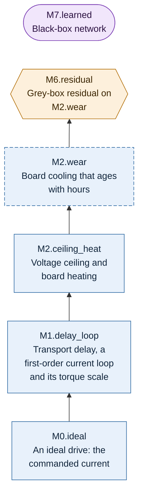

> **Generated file.** Written by [`tools/make_type_docs.py`](../../../../../tools/make_type_docs.py) from this folder's [`ladder.py`](ladder.py): edit the ladder, not this file, then run `python tools/make_type_docs.py` from the repository root.

# foc_controller

A field-oriented-control motor drive board.

**6 rungs** · 7 parameters · 4 aliases · 1 packed names · 3 deployment-only names · folder `actuators/servo/foc_controller/`.

In code: `ladders()["foc_controller"]` from [`robot_models.ladder`](../../../ladder.py). Every type: [docs/TYPES.md](../../../../../docs/TYPES.md). Spec: [PEP 0004](../../../../../docs/peps/0004-model-ladders-by-type.md).
Projects the notes below name, and what they are: [robotparts](../../../../../docs/TYPES.md#name-robotparts), [sim2real](../../../../../docs/TYPES.md#name-sim2real).

## About

From the docstring of [`ladder.py`](ladder.py):

    from robot_models.actuators.servo.foc_controller.ladder import LADDER
    LADDER.parameters("M2.ceiling_heat")   # what the voltage-ceiling and heating rung needs, M1's names included

Rungs: M0 the commanded current as is, M1 the transport delay and first-order current loop, M2 the voltage ceiling and
the board's heating (and M2.wear, the board's cooling ageing with hours), M6 the grey-box residual, M7 the learned net.
A deployment's own settings (torque cap, host loop rate, modulation-limit setting) are not on a rung: see `deployment`.

Spec: PEP 0004 §5.5 and §6.4. Sources: sim2real's `driver` card (its rungs, parameters and equations).

## The ladder

Read it bottom up: each solid arrow runs from a rung's base to the rung that extends it, and a rung needs everything below it on its own chain (its fallback). Blue box: a physics rung; dashed blue box: a wear rung (a parameter that grows with use); amber hexagon: the grey-box residual (M6) on a physics rung; purple rounded box: the learned net (M7), which extends no model.

## Rungs

Bottom up. *Needs* is what the rung's model cannot run without, new over its base; *reads when stated* is what it uses when a source states it. A rung needs everything its base needs.

| rung | title | base | needs (adds) | reads when stated (optional) | code | equation | references |
| --- | --- | --- | --- | --- | --- | --- | --- |
| `M0.ideal` | An ideal drive: the commanded current | — | — | — | — | `i_q = i_cmd (a deployment's torque cap clamps it)` | [KRISHNAN_2010](#ref-krishnan_2010) |
| `M1.delay_loop` | Transport delay, a first-order current loop and its torque scale | [`M0.ideal`](#rung-m0-ideal) | `command_latency`, `current_loop_bandwidth`, `torque_scale` | — | — | `i_q = torque_scale·LPF(current_loop_bandwidth)[i_cmd(t − command_latency)]` | [KRISHNAN_2010](#ref-krishnan_2010) |
| `M2.ceiling_heat` | Voltage ceiling and board heating | [`M1.delay_loop`](#rung-m1-delay_loop) | `voltage_available`, `board_thermal_resistance`, `board_thermal_time_constant` | — | — | `M1.delay_loop clamped to the voltage ceiling (voltage_available − ω·kt/1.5)/R of the motor it drives; board_thermal_time_constant·dΔT/dt = board_thermal_resistance·P_loss − ΔT, ΔT the board's rise over ambient` | [KRAUSE_2013](#ref-krause_2013), [KRISHNAN_2010](#ref-krishnan_2010) |
| `M2.wear` | Board cooling that ages with hours wears `board_thermal_resistance`: see [Wear](#wear) | [`M2.ceiling_heat`](#rung-m2-ceiling_heat) | `board_thermal_growth` | — | — | `board_thermal_resistance(h) = board_thermal_resistance + board_thermal_growth·h` | [LU_MEEKER_1993](#ref-lu_meeker_1993), [MEEKER_1998](#ref-meeker_1998) |
| `M6.residual` | Grey-box residual on M2.wear | [`M2.wear`](#rung-m2-wear) | — | — | — | `M2.wear + an MLP residual q-current from 3 samples of current command, rotor speed and bus voltage` | [NGUYEN_TUONG_2010](#ref-nguyen_tuong_2010) |
| `M7.learned` | Black-box network | — | — | — | — | `an MLP over 3 samples of current command, rotor speed, bus voltage and board temperature → q-current` | [HWANGBO_2019](#ref-hwangbo_2019) |

## Wear

Which parameter grows with use, with what, by which law, at which rate.

| rung | parameter that wears | grows with | law | rate |
| --- | --- | --- | --- | --- |
| [`M2.wear`](#rung-m2-wear) | [`board_thermal_resistance`](#param-board_thermal_resistance) | deployment hours (h) | linear: `p(u) = p0 + k·u` | [`board_thermal_growth`](#param-board_thermal_growth) |

## Vocabulary

Every parameter the ladder holds, by the rung that first reads it. — as a unit: dimensionless (a ratio or a count).

| parameter | SI unit | shape | definition | first read on |
| --- | --- | --- | --- | --- |
| `command_latency` | s | scalar | Time from a command reaching the drive to its first response: the transport delay before the current loop. | [`M1.delay_loop`](#rung-m1-delay_loop) |
| `current_loop_bandwidth` | Hz | scalar | The drive's closed-loop current (torque) bandwidth: the corner of its first-order current loop. | [`M1.delay_loop`](#rung-m1-delay_loop) |
| `torque_scale` | — | scalar | Torque the drive delivers over the torque it was commanded: its torque-constant calibration error. | [`M1.delay_loop`](#rung-m1-delay_loop) |
| `voltage_available` | V | scalar | The largest phase voltage the drive can apply: its bus voltage times its modulation limit. | [`M2.ceiling_heat`](#rung-m2-ceiling_heat) |
| `board_thermal_resistance` | K/W | scalar | The board's temperature rise per watt it dissipates. | [`M2.ceiling_heat`](#rung-m2-ceiling_heat) |
| `board_thermal_time_constant` | s | scalar | Time constant of the board temperature's first-order rise. | [`M2.ceiling_heat`](#rung-m2-ceiling_heat) |
| `board_thermal_growth` | K/W/h | scalar | How fast board_thermal_resistance grows per deployment hour (its cooling ageing). | [`M2.wear`](#rung-m2-wear) |

## Aliases

Other names a source uses for one of these parameters. A note says how it differs when it is not the same quantity one for one. The unit is the one the source writes its values in; *(canonical)* after it marks an alias stored with no unit of its own, which robot_models reads as the canonical parameter's SI unit, shown here spelled out. A note can still qualify that unit.

| alias | canonical | unit | note |
| --- | --- | --- | --- |
| `board_thermal_growth_per_h` | [`board_thermal_growth`](#param-board_thermal_growth) | K/W/h *(canonical)* |   |
| `command_delay_s` | [`command_latency`](#param-command_latency) | s *(canonical)* | The twin's transport delay; the registry's command_latency is measured host to first response over a named bus. |
| `current_loop_hz` | [`current_loop_bandwidth`](#param-current_loop_bandwidth) | Hz *(canonical)* | The twin's first-order loop corner, which is its −3 dB bandwidth. |
| `voltage_available_v` | [`voltage_available`](#param-voltage_available) | V *(canonical)* |   |

## Packed names

Names for one array that carries several of these parameters; never read as one parameter.

| packed name | carries | order | note |
| --- | --- | --- | --- |
| `board_thermal` | [`board_thermal_resistance`](#param-board_thermal_resistance), [`board_thermal_time_constant`](#param-board_thermal_time_constant) | its full entry order | sim2real's driver card: (K/W, s). |

## Deployment-only names

Names some model reads that are not the type's own: a deployment sets them, or the mount gives them.

- *config*: a setting a deployment writes (a gain, a cap, a rate): read from its config, never fitted to the type.

| name | role | where it belongs |
| --- | --- | --- |
| `max_voltage_factor` | config | The firmware's modulation-limit setting: the deployment's config. |
| `telemetry_rate_hz` | config | The host loop's rate: the deployment's config. |
| `torque_cap_nm` | config | The runner's torque cap: the deployment's config. |

## References

The works the rungs cite, by their names in [`robot_models.references`](../../../references.py).

- **HWANGBO_2019**: Hwangbo, Lee, Dosovitskiy, Bellicoso, Tsounis, Koltun, Hutter (2019). Learning agile and dynamic motor skills for legged robots. Science Robotics. [doi:10.1126/scirobotics.aau5872](https://doi.org/10.1126/scirobotics.aau5872). What the rung uses: ANYmal's actuator net: an MLP over position error and velocity at t, t − 10 ms, t − 20 ms, 3 × 32 softsign (arXiv:1901.08652). Cited by [`M7.learned`](#rung-m7-learned).
- **KRAUSE_2013**: Krause, Wasynczuk, Sudhoff, Pekarek (2013). Analysis of Electric Machinery and Drive Systems, 3rd ed. Wiley-IEEE Press. [doi:10.1002/9781118524336](https://doi.org/10.1002/9781118524336) (book). What the rung uses: the PM machine's electrical model: R, L, back-EMF, the voltage ceiling. Cited by [`M2.ceiling_heat`](#rung-m2-ceiling_heat).
- **KRISHNAN_2010**: Krishnan (2010). Permanent Magnet Synchronous and Brushless DC Motor Drives. CRC Press. [doi:10.1201/9781420014235](https://doi.org/10.1201/9781420014235) (book). What the rung uses: field-oriented current loops of PM drives. Cited by [`M0.ideal`](#rung-m0-ideal), [`M1.delay_loop`](#rung-m1-delay_loop), [`M2.ceiling_heat`](#rung-m2-ceiling_heat).
- **LU_MEEKER_1993**: Lu, Meeker (1993). Using degradation measures to estimate a time-to-failure distribution. Technometrics. [doi:10.1080/00401706.1993.10485038](https://doi.org/10.1080/00401706.1993.10485038). What the rung uses: a degradation path in usage, linear the simplest, crossing a failure threshold. Cited by [`M2.wear`](#rung-m2-wear).
- **MEEKER_1998**: Meeker, Escobar, Lu (1998). Accelerated degradation tests: modeling and analysis. Technometrics. [doi:10.1080/00401706.1998.10485191](https://doi.org/10.1080/00401706.1998.10485191). What the rung uses: degradation paths fitted and extrapolated to a threshold. Cited by [`M2.wear`](#rung-m2-wear).
- **NGUYEN_TUONG_2010**: Nguyen-Tuong, Peters (2010). Using model knowledge for learning inverse dynamics. IEEE International Conference on Robotics and Automation. [doi:10.1109/ROBOT.2010.5509858](https://doi.org/10.1109/ROBOT.2010.5509858). What the rung uses: a physics model plus a learned residual. Cited by [`M6.residual`](#rung-m6-residual).
