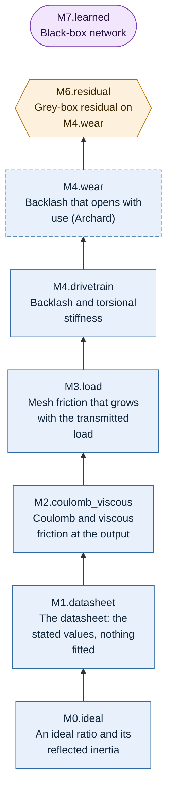

> **Generated file.** Written by [`tools/make_type_docs.py`](../../../../../tools/make_type_docs.py) from this folder's [`ladder.py`](ladder.py): edit the ladder, not this file, then run `python tools/make_type_docs.py` from the repository root.

# gearbox

A gear stage between a motor and its load.

**8 rungs** · 17 parameters · 10 aliases · 0 packed names · 0 deployment-only names · folder `actuators/servo/gearbox/` · datasheet class [`Gearbox`](gearbox.py), whose typed fields rung `M1.datasheet` states.

In code: `ladders()["gearbox"]` from [`robot_models.ladder`](../../../ladder.py). Every type: [docs/TYPES.md](../../../../../docs/TYPES.md). Spec: [PEP 0004](../../../../../docs/peps/0004-model-ladders-by-type.md).
Projects the notes below name, and what they are: [MuJoCo](../../../../../docs/TYPES.md#name-mujoco), [robotparts](../../../../../docs/TYPES.md#name-robotparts), [sim2real](../../../../../docs/TYPES.md#name-sim2real).

## About

From the docstring of [`ladder.py`](ladder.py):

The ladder climbs from the ideal ratio (M0) through the datasheet's stated values (M1), no-load friction (M2),
friction that grows with the transmitted load (M3) and backlash with torsional stiffness (M4), to backlash that opens
with use (M4.wear), a grey-box residual (M6) and a black-box network (M7).

Its vocabulary is the `Gearbox` datasheet's typed fields (which M1 states) plus the names a fit adds on the rungs
above. A gearbox has no packed names and no deployment-only names: its parameters are all its own.

Spec: PEP 0004 §5.4 and §6.3.

## The ladder

Read it bottom up: each solid arrow runs from a rung's base to the rung that extends it, and a rung needs everything below it on its own chain (its fallback). Blue box: a physics rung; dashed blue box: a wear rung (a parameter that grows with use); amber hexagon: the grey-box residual (M6) on a physics rung; purple rounded box: the learned net (M7), which extends no model.

## Rungs

Bottom up. *Needs* is what the rung's model cannot run without, new over its base; *reads when stated* is what it uses when a source states it. A rung needs everything its base needs.

| rung | title | base | needs (adds) | reads when stated (optional) | code | equation | references |
| --- | --- | --- | --- | --- | --- | --- | --- |
| `M0.ideal` | An ideal ratio and its reflected inertia *the actuator's M0.ideal for a reducer.* | — | `gear_ratio`, `gearbox_input_inertia` | — | — | `q_out = q_in/gear_ratio; reflected inertia = gear_ratio²·gearbox_input_inertia` | [SICILIANO_2009](#ref-siciliano_2009), [MUJOCO_ARMATURE](#ref-mujoco_armature) |
| `M1.datasheet` | The datasheet: the stated values, nothing fitted | [`M0.ideal`](#rung-m0-ideal) | — | every `Gearbox` typed field its base does not hold: 9 names, each listed under [Vocabulary](#vocabulary) | — | `the ideal ratio, with τ_out = efficiency·gear_ratio·τ_in when efficiency is stated` | [SICILIANO_2009](#ref-siciliano_2009) |
| `M2.coulomb_viscous` | Coulomb and viscous friction at the output *the actuator's M2 on a reducer, its no-load running torque: robotparts' load rung requires both, and its coverage ruler asks a gearbox's M2 for coulomb_friction.* | [`M1.datasheet`](#rung-m1-datasheet) | `coulomb_friction`, `viscous_friction` | — | — | `τ_r = coulomb_friction·sign(v) + viscous_friction·v at the output` | [ARMSTRONG_1994](#ref-armstrong_1994), [OLSSON_1998](#ref-olsson_1998) |
| `M3.load` | Mesh friction that grows with the transmitted load *sim2real's gearbox M3. A fit sets efficiency (η) or friction_load_coefficient (μ), never both: driving forward μ = (1 − η)/η.* | [`M2.coulomb_viscous`](#rung-m2-coulomb_viscous) | `efficiency`, `output_friction_fraction` | `friction_load_coefficient` | — | `τ_out = efficiency·gear_ratio·τ_in; output_friction_fraction of the friction acts on the output side; with friction_load_coefficient μ the friction is coulomb_friction + μ·abs(τ_load)` | [KIRCANSKI_1997](#ref-kircanski_1997), [OLSSON_1998](#ref-olsson_1998) |
| `M4.drivetrain` | Backlash and torsional stiffness | [`M3.load`](#rung-m3-load) | `backlash`, `torsional_stiffness` | — | — | `q_out = q_in/gear_ratio + lash(τ, backlash) + τ/torsional_stiffness` | [KIRCANSKI_1997](#ref-kircanski_1997), [NORDIN_2002](#ref-nordin_2002), [TUTTLE_1996](#ref-tuttle_1996) |
| `M4.wear` | Backlash that opens with use (Archard) wears `backlash`: see [Wear](#wear) | [`M4.drivetrain`](#rung-m4-drivetrain) | `backlash_wear` | — | — | `backlash(u) = backlash + backlash_wear·Σ\|τ\|·Δrev, over the output revolutions Δrev` | [ARCHARD_1953](#ref-archard_1953), [FLODIN_1997](#ref-flodin_1997) |
| `M6.residual` | Grey-box residual on M4.wear | [`M4.wear`](#rung-m4-wear) | — | — | — | `M4.wear + an MLP residual transmission error from 3 samples of input angle, output torque and input speed` | [NGUYEN_TUONG_2010](#ref-nguyen_tuong_2010), [ZENG_2020](#ref-zeng_2020) |
| `M7.learned` | Black-box network | — | — | — | — | `an MLP over 5 samples of input angle, input speed and output torque → output angle error` | [HWANGBO_2019](#ref-hwangbo_2019), [ZHU_2025](#ref-zhu_2025) |

## Wear

Which parameter grows with use, with what, by which law, at which rate.

| rung | parameter that wears | grows with | law | rate |
| --- | --- | --- | --- | --- |
| [`M4.wear`](#rung-m4-wear) | [`backlash`](#param-backlash) | torque-weighted output revolutions (N·m·rev) | archard: `p(u) = p0 + k·Σ(load·distance): wear grows with the load carried times the distance slid` | [`backlash_wear`](#param-backlash_wear) |

## Vocabulary

Every parameter the ladder holds, by the rung that first reads it. — as a unit: dimensionless (a ratio or a count).

| parameter | SI unit | shape | definition | first read on |
| --- | --- | --- | --- | --- |
| `gear_ratio` | — | scalar | Input turns per output turn, > 0. | [`M0.ideal`](#rung-m0-ideal) |
| `gearbox_input_inertia` | kg·m² | scalar | Inertia referred to the input shaft. | [`M0.ideal`](#rung-m0-ideal) |
| `rated_torque` | N·m | scalar | Continuous torque at the output. | [`M1.datasheet`](#rung-m1-datasheet) (when stated) |
| `peak_torque` | N·m | scalar | Peak torque at the output. | [`M1.datasheet`](#rung-m1-datasheet) (when stated) |
| `backlash` | rad | scalar | Backlash at the output. | [`M1.datasheet`](#rung-m1-datasheet) (when stated); needed from [`M4.drivetrain`](#rung-m4-drivetrain) |
| `efficiency` | — | scalar | Power out over power in, at the source's operating point. | [`M1.datasheet`](#rung-m1-datasheet) (when stated); needed from [`M3.load`](#rung-m3-load) |
| `mass` | kg | scalar | Mass as sold. | [`M1.datasheet`](#rung-m1-datasheet) (when stated) |
| `outer_diameter` | m | scalar | Largest diameter of a round housing. | [`M1.datasheet`](#rung-m1-datasheet) (when stated) |
| `axial_length` | m | scalar | Overall length along the axis. | [`M1.datasheet`](#rung-m1-datasheet) (when stated) |
| `max_axial_load` | N | scalar | Largest axial load on the output (catalogue name). | [`M1.datasheet`](#rung-m1-datasheet) (when stated) |
| `max_radial_load` | N | scalar | Largest radial load on the output (catalogue name). | [`M1.datasheet`](#rung-m1-datasheet) (when stated) |
| `coulomb_friction` | N·m | scalar | Coulomb friction torque at the output: the constant torque that opposes motion. | [`M2.coulomb_viscous`](#rung-m2-coulomb_viscous) |
| `viscous_friction` | N·m·s/rad | scalar | Viscous friction coefficient at the output. | [`M2.coulomb_viscous`](#rung-m2-coulomb_viscous) |
| `friction_load_coefficient` | — | scalar | Extra output friction per N·m of load torque the part transmits: Fc + μ·abs(τ_load). | [`M3.load`](#rung-m3-load) (when stated) |
| `output_friction_fraction` | — | scalar | The share of the reducer's friction that acts on its output side. | [`M3.load`](#rung-m3-load) |
| `torsional_stiffness` | N·m/rad | scalar | Drivetrain stiffness at the output with the rotor held: output torque per radian of twist. | [`M4.drivetrain`](#rung-m4-drivetrain) |
| `backlash_wear` | rad/(N·m·rev) | scalar | How fast backlash opens per torque-weighted output revolution (Archard). | [`M4.wear`](#rung-m4-wear) |

## Aliases

Other names a source uses for one of these parameters. A note says how it differs when it is not the same quantity one for one. The unit is the one the source writes its values in; *(canonical)* after it marks an alias stored with no unit of its own, which robot_models reads as the canonical parameter's SI unit, shown here spelled out. A note can still qualify that unit.

| alias | canonical | unit | note |
| --- | --- | --- | --- |
| `backlash_arcmin` | [`backlash`](#param-backlash) | arcmin |   |
| `backlash_rad` | [`backlash`](#param-backlash) | rad *(canonical)* |   |
| `backlash_wear_rad_per_nm_rev` | [`backlash_wear`](#param-backlash_wear) | rad/(N·m·rev) *(canonical)* |   |
| `gear_stiffness_nm_rad` | [`torsional_stiffness`](#param-torsional_stiffness) | N·m/rad *(canonical)* | Fitted on a mounted unit: it includes the mount's compliance. |
| `length_mm` | [`axial_length`](#param-axial_length) | mm |   |
| `mass_kg` | [`mass`](#param-mass) | kg *(canonical)* |   |
| `mesh_efficiency_eta` | [`efficiency`](#param-efficiency) | dimensionless *(canonical)* | The twin's constant η in τ_out = η·N·τ_in; a datasheet's efficiency is at its stated operating point; μ = (1 − η)/η driving forward. |
| `od_mm` | [`outer_diameter`](#param-outer_diameter) | mm |   |
| `peak_torque_nm` | [`peak_torque`](#param-peak_torque) | N·m *(canonical)* |   |
| `rated_torque_nm` | [`rated_torque`](#param-rated_torque) | N·m *(canonical)* |   |

## Packed names

Names for one array that carries several of these parameters; never read as one parameter.

None.

## Deployment-only names

Names some model reads that are not the type's own: a deployment sets them, or the mount gives them.

None.

## References

The works the rungs cite, by their names in [`robot_models.references`](../../../references.py).

- **ARCHARD_1953**: Archard (1953). Contact and rubbing of flat surfaces. Journal of Applied Physics. [doi:10.1063/1.1721448](https://doi.org/10.1063/1.1721448). What the rung uses: wear volume grows with the load carried times the distance slid. Cited by [`M4.wear`](#rung-m4-wear).
- **ARMSTRONG_1994**: Armstrong-Hélouvry, Dupont, Canudas de Wit (1994). A survey of models, analysis tools and compensation methods for the control of machines with friction. Automatica. [doi:10.1016/0005-1098(94)90209-7](https://doi.org/10.1016/0005-1098%2894%2990209-7). What the rung uses: Coulomb, viscous and Stribeck friction. Cited by [`M2.coulomb_viscous`](#rung-m2-coulomb_viscous).
- **FLODIN_1997**: Flodin, Andersson (1997). Simulation of mild wear in spur gears. Wear. [doi:10.1016/S0043-1648(96)07467-4](https://doi.org/10.1016/S0043-1648%2896%2907467-4). What the rung uses: Archard's law on gear teeth: the flank wear that opens backlash. Cited by [`M4.wear`](#rung-m4-wear).
- **HWANGBO_2019**: Hwangbo, Lee, Dosovitskiy, Bellicoso, Tsounis, Koltun, Hutter (2019). Learning agile and dynamic motor skills for legged robots. Science Robotics. [doi:10.1126/scirobotics.aau5872](https://doi.org/10.1126/scirobotics.aau5872). What the rung uses: ANYmal's actuator net: an MLP over position error and velocity at t, t − 10 ms, t − 20 ms, 3 × 32 softsign (arXiv:1901.08652). Cited by [`M7.learned`](#rung-m7-learned).
- **KIRCANSKI_1997**: Kircanski, Goldenberg (1997). An experimental study of nonlinear stiffness, hysteresis, and friction effects in robot joints with harmonic drives and torque sensors. The International Journal of Robotics Research. [doi:10.1177/027836499701600207](https://doi.org/10.1177/027836499701600207). What the rung uses: load-dependent friction and torsional stiffness measured in a joint. Cited by [`M3.load`](#rung-m3-load), [`M4.drivetrain`](#rung-m4-drivetrain).
- **MUJOCO_ARMATURE**: MuJoCo (2026). XML reference: joint armature. [https://mujoco.readthedocs.io/en/stable/XMLreference.html#body-joint-armature](https://mujoco.readthedocs.io/en/stable/XMLreference.html#body-joint-armature) (doc). What the rung uses: the rotor's inertia reflected through the gear, as the simulator takes it. Cited by [`M0.ideal`](#rung-m0-ideal).
- **NGUYEN_TUONG_2010**: Nguyen-Tuong, Peters (2010). Using model knowledge for learning inverse dynamics. IEEE International Conference on Robotics and Automation. [doi:10.1109/ROBOT.2010.5509858](https://doi.org/10.1109/ROBOT.2010.5509858). What the rung uses: a physics model plus a learned residual. Cited by [`M6.residual`](#rung-m6-residual).
- **NORDIN_2002**: Nordin, Gutman (2002). Controlling mechanical systems with backlash—a survey. Automatica. [doi:10.1016/S0005-1098(02)00047-X](https://doi.org/10.1016/S0005-1098%2802%2900047-X). What the rung uses: dead-zone backlash between motor and load. Cited by [`M4.drivetrain`](#rung-m4-drivetrain).
- **OLSSON_1998**: Olsson, Åström, Canudas de Wit, Gäfvert, Lischinsky (1998). Friction models and friction compensation. European Journal of Control. [doi:10.1016/S0947-3580(98)70113-X](https://doi.org/10.1016/S0947-3580%2898%2970113-X). What the rung uses: static friction models from Coulomb + viscous to Stribeck. Cited by [`M2.coulomb_viscous`](#rung-m2-coulomb_viscous), [`M3.load`](#rung-m3-load).
- **SICILIANO_2009**: Siciliano, Sciavicco, Villani, Oriolo (2009). Robotics: Modelling, Planning and Control. Springer. [doi:10.1007/978-1-84628-642-1](https://doi.org/10.1007/978-1-84628-642-1) (book). What the rung uses: rigid-body joint dynamics and reflected inertia. Cited by [`M0.ideal`](#rung-m0-ideal), [`M1.datasheet`](#rung-m1-datasheet).
- **TUTTLE_1996**: Tuttle, Seering (1996). A nonlinear model of a harmonic drive gear transmission. IEEE Transactions on Robotics and Automation. [doi:10.1109/70.499819](https://doi.org/10.1109/70.499819). What the rung uses: a gear's compliance, friction and kinematic error. Cited by [`M4.drivetrain`](#rung-m4-drivetrain).
- **ZENG_2020**: Zeng, Song, Lee, Rodriguez, Funkhouser (2020). TossingBot: learning to throw arbitrary objects with residual physics. IEEE Transactions on Robotics. [doi:10.1109/TRO.2020.2988642](https://doi.org/10.1109/TRO.2020.2988642). What the rung uses: residual physics: learn what the physics estimate misses. Cited by [`M6.residual`](#rung-m6-residual).
- **ZHU_2025**: Zhu, Tanaka, Rafeedi, Hong (2025). Cycloidal quasi-direct drive actuator designs with learning-based torque estimation for legged robotics. arXiv:2410.16591. [https://arxiv.org/abs/2410.16591](https://arxiv.org/abs/2410.16591) (preprint). What the rung uses: a longer history (a 30-step GRU) when ripple or backlash matter. Cited by [`M7.learned`](#rung-m7-learned).
