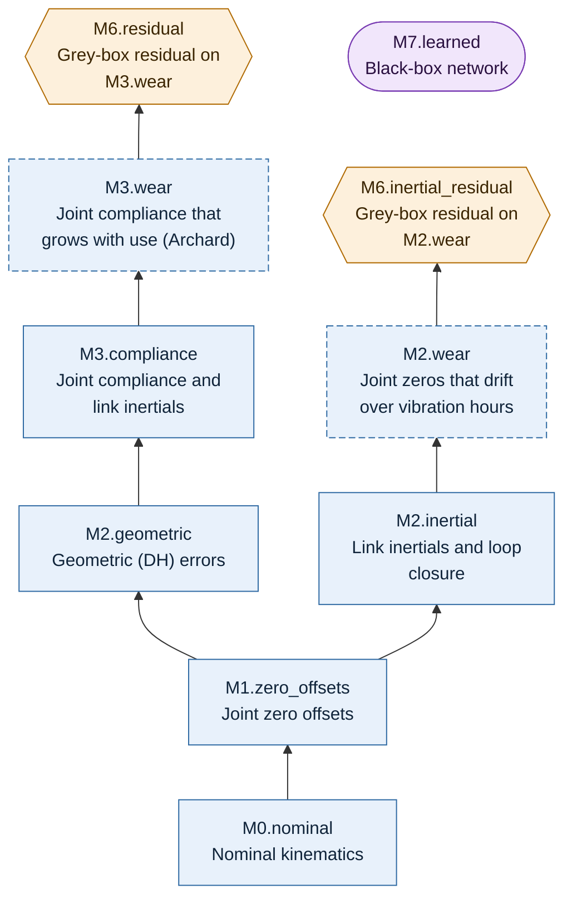

> **Generated file.** Written by [`tools/make_type_docs.py`](../../../../tools/make_type_docs.py) from this folder's [`ladder.py`](ladder.py): edit the ladder, not this file, then run `python tools/make_type_docs.py` from the repository root.

# rigid_body_chain

A chain of rigid links and joints, open or closed: a whole arm, a sub-assembly, a wrist, a five-bar.

**10 rungs** · 8 parameters · 5 aliases · 0 packed names · 2 deployment-only names · folder `arms/rigid_body_chain/`.

In code: `ladders()["rigid_body_chain"]` from [`robot_models.ladder`](../../ladder.py). Every type: [docs/TYPES.md](../../../../docs/TYPES.md). Spec: [PEP 0004](../../../../docs/peps/0004-model-ladders-by-type.md).
Projects the notes below name, and what they are: [sim2real](../../../../docs/TYPES.md#name-sim2real).

## About

From the docstring of [`ladder.py`](ladder.py), less a paragraph on the order that file reads in (this page shows the ladder, then the rungs, then the names):

Spec: PEP 0004 §5.10 and §6.9 (and §0 flag 2: arm is folded into this type, per Zach Nov 6 "the 6 DOF robot arm is
not a type").

The ladder forks after M1.zero_offsets into two branches that both fall back on it:

- the kinematic branch (a whole arm): M2.geometric (DH errors), M3.compliance, M3.wear, then the residual M6.residual;
- the dynamic branch (a sub-assembly, a closed chain): M2.inertial, M2.wear, then the residual M6.inertial_residual.

## The ladder

Read it bottom up: each solid arrow runs from a rung's base to the rung that extends it, and a rung needs everything below it on its own chain (its fallback). Blue box: a physics rung; dashed blue box: a wear rung (a parameter that grows with use); amber hexagon: the grey-box residual (M6) on a physics rung; purple rounded box: the learned net (M7), which extends no model.

## Rungs

Bottom up. *Needs* is what the rung's model cannot run without, new over its base; *reads when stated* is what it uses when a source states it. A rung needs everything its base needs.

| rung | title | base | needs (adds) | reads when stated (optional) | code | equation | references |
| --- | --- | --- | --- | --- | --- | --- | --- |
| `M0.nominal` | Nominal kinematics | — | `link_geometry` | — | — | `tool = FK(q; link_geometry)` | [SICILIANO_2009](#ref-siciliano_2009), [DH_1955](#ref-dh_1955) |
| `M1.zero_offsets` | Joint zero offsets | [`M0.nominal`](#rung-m0-nominal) | `joint_zero_offsets` | — | — | `tool = FK(q + joint_zero_offsets; link_geometry)` | [HOLLERBACH_WAMPLER_1996](#ref-hollerbach_wampler_1996) |
| `M2.geometric` | Geometric (DH) errors *sim2real's arm M2: the kinematic branch of an open chain.* | [`M1.zero_offsets`](#rung-m1-zero_offsets) | `dh_errors` | — | — | `tool = FK(q + joint_zero_offsets; link_geometry + dh_errors)` | [HAYATI_1983](#ref-hayati_1983), [OKAMURA_1996](#ref-okamura_1996), [HOLLERBACH_2016](#ref-hollerbach_2016) |
| `M2.inertial` | Link inertials and loop closure *sim2real's arm sub-assembly M2: the dynamic branch, which needs no DH errors.* | [`M1.zero_offsets`](#rung-m1-zero_offsets) | `link_inertials`, `closure_tolerance` | — | — | `tool = FK(q + joint_zero_offsets; link_geometry); dynamics from link_inertials with each joint's own type; a closed loop may stay open by closure_tolerance` | [ATKESON_1986](#ref-atkeson_1986), [GAUTIER_1990](#ref-gautier_1990), [SWEVERS_1997](#ref-swevers_1997) |
| `M2.wear` | Joint zeros that drift over vibration hours wears `joint_zero_offsets`: see [Wear](#wear) | [`M2.inertial`](#rung-m2-inertial) | `joint_zero_drift` | — | — | `joint_zero_offsets(h) = joint_zero_offsets + joint_zero_drift·√h` | [JUNKER_1969](#ref-junker_1969), [WHITMORE_1995](#ref-whitmore_1995) |
| `M3.compliance` | Joint compliance and link inertials | [`M2.geometric`](#rung-m2-geometric) | `joint_compliance`, `link_inertials` | — | — | `tool = FK(q + joint_zero_offsets + joint_compliance·τ; link_geometry + dh_errors); τ from link_inertials, each joint its own type` | [SPONG_1987](#ref-spong_1987), [ATKESON_1986](#ref-atkeson_1986), [GAUTIER_1990](#ref-gautier_1990), [SWEVERS_1997](#ref-swevers_1997) |
| `M3.wear` | Joint compliance that grows with use (Archard) wears `joint_compliance`: see [Wear](#wear) | [`M3.compliance`](#rung-m3-compliance) | `compliance_wear` | — | — | `joint_compliance(u) = joint_compliance + compliance_wear·Σ\|τ\|·Δrev` | [ARCHARD_1953](#ref-archard_1953), [FLODIN_1997](#ref-flodin_1997) |
| `M6.residual` | Grey-box residual on M3.wear | [`M3.wear`](#rung-m3-wear) | — | — | — | `M3.wear + an MLP residual of joint torques from 3 samples of each joint's error, speed and torque` | [NGUYEN_TUONG_2010](#ref-nguyen_tuong_2010), [ZENG_2020](#ref-zeng_2020) |
| `M6.inertial_residual` | Grey-box residual on M2.wear *the residual of the dynamic branch (sim2real's arm sub-assembly M6).* | [`M2.wear`](#rung-m2-wear) | — | — | — | `M2.wear + an MLP residual of joint torques from 3 samples of each joint's error, speed and torque` | [NGUYEN_TUONG_2010](#ref-nguyen_tuong_2010), [ZENG_2020](#ref-zeng_2020) |
| `M7.learned` | Black-box network | — | — | — | — | `an MLP over 3 samples of each joint's error and speed → joint torques` | [HWANGBO_2019](#ref-hwangbo_2019) |

## Wear

Which parameter grows with use, with what, by which law, at which rate.

| rung | parameter that wears | grows with | law | rate |
| --- | --- | --- | --- | --- |
| [`M2.wear`](#rung-m2-wear) | [`joint_zero_offsets`](#param-joint_zero_offsets) | vibration hours (h) | sqrt: `p(u) = p0 + k·√u` | [`joint_zero_drift`](#param-joint_zero_drift) |
| [`M3.wear`](#rung-m3-wear) | [`joint_compliance`](#param-joint_compliance) | torque-weighted joint revolutions (N·m·rev) | archard: `p(u) = p0 + k·Σ(load·distance): wear grows with the load carried times the distance slid` | [`compliance_wear`](#param-compliance_wear) |

## Vocabulary

Every parameter the ladder holds, by the rung that first reads it. — as a unit: dimensionless (a ratio or a count).

| parameter | SI unit | shape | definition | first read on |
| --- | --- | --- | --- | --- |
| `link_geometry` | m, rad | per joint | The chain's nominal joint axes and link frames, as a URDF, a DH table or a CAD export states them. | [`M0.nominal`](#rung-m0-nominal) |
| `joint_zero_offsets` | rad | per joint | Each joint's offset between its encoder zero and its kinematic zero. | [`M1.zero_offsets`](#rung-m1-zero_offsets) |
| `dh_errors` | m, rad | per joint | Errors of the chain's DH parameters from their nominal values. | [`M2.geometric`](#rung-m2-geometric) |
| `link_inertials` | kg, m, kg·m² | per link | Each link's mass, centre of mass and inertia tensor. | [`M2.inertial`](#rung-m2-inertial) |
| `closure_tolerance` | m | scalar | How far a closed chain's loop may stay open at its closure joint. | [`M2.inertial`](#rung-m2-inertial) |
| `joint_zero_drift` | rad/√h | scalar | How fast the joint zero offsets drift with the square root of vibration hours. | [`M2.wear`](#rung-m2-wear) |
| `joint_compliance` | rad/(N·m) | per joint | Each joint's deflection per N·m it carries. | [`M3.compliance`](#rung-m3-compliance) |
| `compliance_wear` | rad/(N·m)/(N·m·rev) | scalar | How fast joint_compliance grows per torque-weighted joint revolution (Archard). | [`M3.wear`](#rung-m3-wear) |

## Aliases

Other names a source uses for one of these parameters. A note says how it differs when it is not the same quantity one for one. The unit is the one the source writes its values in; *(canonical)* after it marks an alias stored with no unit of its own, which robot_models reads as the canonical parameter's SI unit, shown here spelled out. A note can still qualify that unit.

| alias | canonical | unit | note |
| --- | --- | --- | --- |
| `compliance_wear_per_nm_rev` | [`compliance_wear`](#param-compliance_wear) | rad/(N·m)/(N·m·rev) *(canonical)* |   |
| `joint_offset_drift_rad_per_sqrt_h` | [`joint_zero_drift`](#param-joint_zero_drift) | rad/√h *(canonical)* |   |
| `joint_offsets` | [`joint_zero_offsets`](#param-joint_zero_offsets) | rad *(canonical)* |   |
| `joint_zero_drift_rad_per_sqrt_h` | [`joint_zero_drift`](#param-joint_zero_drift) | rad/√h *(canonical)* |   |
| `link_lengths` | [`link_geometry`](#param-link_geometry) | m, rad *(canonical)* | Lengths only: the geometry also carries the joint axes. |

## Packed names

Names for one array that carries several of these parameters; never read as one parameter.

None.

## Deployment-only names

Names some model reads that are not the type's own: a deployment sets them, or the mount gives them.

- *assembly*: a property of where the part is mounted (the station's gravity, a base frame): the description's.

| name | role | where it belongs |
| --- | --- | --- |
| `base_frame` | assembly | Where the chain stands in its cell: the description's. |
| `tool_frame` | assembly | The tool mounted on its flange: the description's. |

## References

The works the rungs cite, by their names in [`robot_models.references`](../../references.py).

- **ARCHARD_1953**: Archard (1953). Contact and rubbing of flat surfaces. Journal of Applied Physics. [doi:10.1063/1.1721448](https://doi.org/10.1063/1.1721448). What the rung uses: wear volume grows with the load carried times the distance slid. Cited by [`M3.wear`](#rung-m3-wear).
- **ATKESON_1986**: Atkeson, An, Hollerbach (1986). Estimation of inertial parameters of manipulator loads and links. The International Journal of Robotics Research. [doi:10.1177/027836498600500306](https://doi.org/10.1177/027836498600500306). What the rung uses: link and load inertials by least squares. Cited by [`M2.inertial`](#rung-m2-inertial), [`M3.compliance`](#rung-m3-compliance).
- **DH_1955**: Denavit, Hartenberg (1955). A kinematic notation for lower-pair mechanisms based on matrices. Journal of Applied Mechanics. [doi:10.1115/1.4011045](https://doi.org/10.1115/1.4011045). What the rung uses: the DH parameters of a serial chain. Cited by [`M0.nominal`](#rung-m0-nominal).
- **FLODIN_1997**: Flodin, Andersson (1997). Simulation of mild wear in spur gears. Wear. [doi:10.1016/S0043-1648(96)07467-4](https://doi.org/10.1016/S0043-1648%2896%2907467-4). What the rung uses: Archard's law on gear teeth: the flank wear that opens backlash. Cited by [`M3.wear`](#rung-m3-wear).
- **GAUTIER_1990**: Gautier, Khalil (1990). Direct calculation of minimum set of inertial parameters of serial robots. IEEE Transactions on Robotics and Automation. [doi:10.1109/70.56655](https://doi.org/10.1109/70.56655). What the rung uses: the base inertial parameters an arm can identify. Cited by [`M2.inertial`](#rung-m2-inertial), [`M3.compliance`](#rung-m3-compliance).
- **HAYATI_1983**: Hayati (1983). Robot arm geometric link parameter estimation. The 22nd IEEE Conference on Decision and Control. [doi:10.1109/CDC.1983.269783](https://doi.org/10.1109/CDC.1983.269783). What the rung uses: modified DH for parallel axes, the form kinematic calibration fits. Cited by [`M2.geometric`](#rung-m2-geometric).
- **HOLLERBACH_2016**: Hollerbach, Khalil, Gautier (2016). Model identification. In Springer Handbook of Robotics, 2nd ed. Springer. [doi:10.1007/978-3-319-32552-1_6](https://doi.org/10.1007/978-3-319-32552-1_6) (chapter). What the rung uses: kinematic calibration and inertial identification, one chapter. Cited by [`M2.geometric`](#rung-m2-geometric).
- **HOLLERBACH_WAMPLER_1996**: Hollerbach, Wampler (1996). The calibration index and taxonomy for robot kinematic calibration methods. The International Journal of Robotics Research. [doi:10.1177/027836499601500604](https://doi.org/10.1177/027836499601500604). What the rung uses: open- and closed-loop kinematic calibration. Cited by [`M1.zero_offsets`](#rung-m1-zero_offsets).
- **HWANGBO_2019**: Hwangbo, Lee, Dosovitskiy, Bellicoso, Tsounis, Koltun, Hutter (2019). Learning agile and dynamic motor skills for legged robots. Science Robotics. [doi:10.1126/scirobotics.aau5872](https://doi.org/10.1126/scirobotics.aau5872). What the rung uses: ANYmal's actuator net: an MLP over position error and velocity at t, t − 10 ms, t − 20 ms, 3 × 32 softsign (arXiv:1901.08652). Cited by [`M7.learned`](#rung-m7-learned).
- **JUNKER_1969**: Junker (1969). New criteria for self-loosening of fasteners under vibration. SAE Technical Paper. [doi:10.4271/690055](https://doi.org/10.4271/690055). What the rung uses: a mount loosening under transverse vibration. Cited by [`M2.wear`](#rung-m2-wear).
- **NGUYEN_TUONG_2010**: Nguyen-Tuong, Peters (2010). Using model knowledge for learning inverse dynamics. IEEE International Conference on Robotics and Automation. [doi:10.1109/ROBOT.2010.5509858](https://doi.org/10.1109/ROBOT.2010.5509858). What the rung uses: a physics model plus a learned residual. Cited by [`M6.residual`](#rung-m6-residual), [`M6.inertial_residual`](#rung-m6-inertial_residual).
- **OKAMURA_1996**: Okamura, Park (1996). Kinematic calibration using the product of exponentials formula. Robotica. [doi:10.1017/S0263574700019810](https://doi.org/10.1017/S0263574700019810). What the rung uses: a singularity-free calibration parameterisation. Cited by [`M2.geometric`](#rung-m2-geometric).
- **SICILIANO_2009**: Siciliano, Sciavicco, Villani, Oriolo (2009). Robotics: Modelling, Planning and Control. Springer. [doi:10.1007/978-1-84628-642-1](https://doi.org/10.1007/978-1-84628-642-1) (book). What the rung uses: rigid-body joint dynamics and reflected inertia. Cited by [`M0.nominal`](#rung-m0-nominal).
- **SPONG_1987**: Spong (1987). Modeling and control of elastic joint robots. Journal of Dynamic Systems, Measurement, and Control. [doi:10.1115/1.3143860](https://doi.org/10.1115/1.3143860). What the rung uses: joint compliance as a spring between motor and link. Cited by [`M3.compliance`](#rung-m3-compliance).
- **SWEVERS_1997**: Swevers, Ganseman, Tükel, De Schutter, Van Brussel (1997). Optimal robot excitation and identification. IEEE Transactions on Robotics and Automation. [doi:10.1109/70.631234](https://doi.org/10.1109/70.631234). What the rung uses: periodic excitation trajectories for dynamic identification. Cited by [`M2.inertial`](#rung-m2-inertial), [`M3.compliance`](#rung-m3-compliance).
- **WHITMORE_1995**: Whitmore (1995). Estimating degradation by a Wiener diffusion process subject to measurement error. Lifetime Data Analysis. [doi:10.1007/BF00985762](https://doi.org/10.1007/BF00985762). What the rung uses: diffusive drift: its expected size grows as the square root of time. Cited by [`M2.wear`](#rung-m2-wear).
- **ZENG_2020**: Zeng, Song, Lee, Rodriguez, Funkhouser (2020). TossingBot: learning to throw arbitrary objects with residual physics. IEEE Transactions on Robotics. [doi:10.1109/TRO.2020.2988642](https://doi.org/10.1109/TRO.2020.2988642). What the rung uses: residual physics: learn what the physics estimate misses. Cited by [`M6.residual`](#rung-m6-residual), [`M6.inertial_residual`](#rung-m6-inertial_residual).
