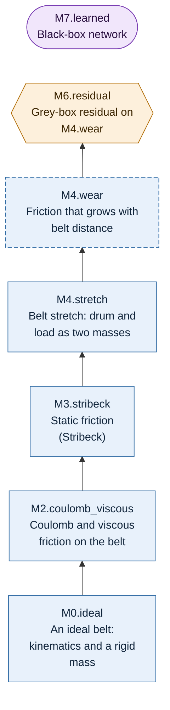

> **Generated file.** Written by [`tools/make_type_docs.py`](../../../../tools/make_type_docs.py) from this folder's [`ladder.py`](ladder.py): edit the ladder, not this file, then run `python tools/make_type_docs.py` from the repository root.

# conveyor

A belt driven through a drum.

**7 rungs** · 10 parameters · 9 aliases · 0 packed names · 2 deployment-only names · folder `conveyors/conveyor/`.

In code: `ladders()["conveyor"]` from [`robot_models.ladder`](../../ladder.py). Every type: [docs/TYPES.md](../../../../docs/TYPES.md). Spec: [PEP 0004](../../../../docs/peps/0004-model-ladders-by-type.md).
Projects the notes below name, and what they are: [sim2real](../../../../docs/TYPES.md#name-sim2real).

## About

From the docstring of [`ladder.py`](ladder.py):

The ladder climbs from an ideal belt (the drum's turns become belt travel, a rigid mass moves under a force) through
friction on the belt, the belt's stretch between drum and load, and friction that grows with the belt's distance, to a
grey-box residual and a black-box network. Its rungs are numbered by the actuator's layers (sim2real's decision, the
same M2 and M3 friction rungs, here as forces on the belt); there is no M1 because the type has no Datasheet class yet.

Spec: PEP 0004 §5.12 and §6.11.

## The ladder

Read it bottom up: each solid arrow runs from a rung's base to the rung that extends it, and a rung needs everything below it on its own chain (its fallback). Blue box: a physics rung; dashed blue box: a wear rung (a parameter that grows with use); amber hexagon: the grey-box residual (M6) on a physics rung; purple rounded box: the learned net (M7), which extends no model.

## Rungs

Bottom up. *Needs* is what the rung's model cannot run without, new over its base; *reads when stated* is what it uses when a source states it. A rung needs everything its base needs.

| rung | title | base | needs (adds) | reads when stated (optional) | code | equation | references |
| --- | --- | --- | --- | --- | --- | --- | --- |
| `M0.ideal` | An ideal belt: kinematics and a rigid mass *numbered by the actuator's layers (sim2real's decision); no M1: no Datasheet class yet.* | — | `drum_radius`, `gear_ratio`, `moving_mass` | — | — | `x = θ_motor·drum_radius/gear_ratio; (moving_mass + load)·ẍ = F` | [ZHANG_XIA_2011](#ref-zhang_xia_2011) |
| `M2.coulomb_viscous` | Coulomb and viscous friction on the belt | [`M0.ideal`](#rung-m0-ideal) | `coulomb_friction`, `viscous_friction` | — | — | `F_f = coulomb_friction·sign(ẋ) + viscous_friction·ẋ` | [ARMSTRONG_1994](#ref-armstrong_1994), [ZHANG_XIA_2011](#ref-zhang_xia_2011) |
| `M3.stribeck` | Static friction (Stribeck) *the actuator's M3.stribeck as forces on the belt.* | [`M2.coulomb_viscous`](#rung-m2-coulomb_viscous) | `breakaway_force`, `stribeck_velocity` | — | — | `F_f = (coulomb_friction + (breakaway_force − coulomb_friction)·exp(−(\|ẋ\|/stribeck_velocity)²))·sign(ẋ) + viscous_friction·ẋ` | [ARMSTRONG_1994](#ref-armstrong_1994) |
| `M4.stretch` | Belt stretch: drum and load as two masses | [`M3.stribeck`](#rung-m3-stribeck) | `stretch_stiffness`, `stretch_damping` | — | — | `load: (moving_mass + load)·ẍ_l = stretch_stiffness·(x_d − x_l) + stretch_damping·(ẋ_d − ẋ_l) − F_f; drum: m_d·ẍ_d = gear_ratio·τ/drum_radius − the same stretch force` | [SPONG_1987](#ref-spong_1987), [HE_2017](#ref-he_2017) |
| `M4.wear` | Friction that grows with belt distance wears `coulomb_friction`: see [Wear](#wear) | [`M4.stretch`](#rung-m4-stretch) | `friction_growth` | — | — | `coulomb_friction(s) = coulomb_friction + friction_growth·s` | [LU_MEEKER_1993](#ref-lu_meeker_1993), [ZHANG_XIA_2011](#ref-zhang_xia_2011) |
| `M6.residual` | Grey-box residual on M4.wear | [`M4.wear`](#rung-m4-wear) | — | — | — | `M4.wear + an MLP residual drive force from 3 samples of belt speed error, belt speed and motor current` | [NGUYEN_TUONG_2010](#ref-nguyen_tuong_2010), [ZENG_2020](#ref-zeng_2020) |
| `M7.learned` | Black-box network | — | — | — | — | `an MLP over 3 samples of position error and belt speed → drive force` | [HWANGBO_2019](#ref-hwangbo_2019), [HWANGBO_2019_ARXIV](#ref-hwangbo_2019_arxiv) |

## Wear

Which parameter grows with use, with what, by which law, at which rate.

| rung | parameter that wears | grows with | law | rate |
| --- | --- | --- | --- | --- |
| [`M4.wear`](#rung-m4-wear) | [`coulomb_friction`](#param-coulomb_friction) | belt distance (km) | linear: `p(u) = p0 + k·u` | [`friction_growth`](#param-friction_growth) |

## Vocabulary

Every parameter the ladder holds, by the rung that first reads it. — as a unit: dimensionless (a ratio or a count).

| parameter | SI unit | shape | definition | first read on |
| --- | --- | --- | --- | --- |
| `drum_radius` | m | scalar | Radius of the drive drum the belt wraps. | [`M0.ideal`](#rung-m0-ideal) |
| `gear_ratio` | — | scalar | Motor turns per drum turn. | [`M0.ideal`](#rung-m0-ideal) |
| `moving_mass` | kg | scalar | The moving mass referred to the belt: belt, drum and reflected rotor. | [`M0.ideal`](#rung-m0-ideal) |
| `coulomb_friction` | N | scalar | Coulomb friction force on the belt: the constant force that opposes its motion. | [`M2.coulomb_viscous`](#rung-m2-coulomb_viscous) |
| `viscous_friction` | N·s/m | scalar | Viscous friction coefficient on the belt. | [`M2.coulomb_viscous`](#rung-m2-coulomb_viscous) |
| `breakaway_force` | N | scalar | Static friction on the belt: the force that starts it moving from rest. | [`M3.stribeck`](#rung-m3-stribeck) |
| `stribeck_velocity` | m/s | scalar | Belt speed over which friction falls from breakaway_force to coulomb_friction. | [`M3.stribeck`](#rung-m3-stribeck) |
| `stretch_stiffness` | N/m | scalar | The belt's stiffness along its length, between drum and load. | [`M4.stretch`](#rung-m4-stretch) |
| `stretch_damping` | N·s/m | scalar | Damping of the belt's stretch between drum and load. | [`M4.stretch`](#rung-m4-stretch) |
| `friction_growth` | N/km | scalar | How fast coulomb_friction grows per kilometre of belt travel (idlers and slider bed wearing). | [`M4.wear`](#rung-m4-wear) |

## Aliases

Other names a source uses for one of these parameters. A note says how it differs when it is not the same quantity one for one. The unit is the one the source writes its values in; *(canonical)* after it marks an alias stored with no unit of its own, which robot_models reads as the canonical parameter's SI unit, shown here spelled out. A note can still qualify that unit.

| alias | canonical | unit | note |
| --- | --- | --- | --- |
| `coulomb_growth_n_per_km` | [`friction_growth`](#param-friction_growth) | N/km *(canonical)* |   |
| `coulomb_n` | [`coulomb_friction`](#param-coulomb_friction) | N *(canonical)* |   |
| `drum_radius_m` | [`drum_radius`](#param-drum_radius) | m *(canonical)* |   |
| `drum_radius_mm` | [`drum_radius`](#param-drum_radius) | mm |   |
| `moving_mass_kg` | [`moving_mass`](#param-moving_mass) | kg *(canonical)* |   |
| `static_n` | [`breakaway_force`](#param-breakaway_force) | N *(canonical)* |   |
| `stretch_damping_n_s_m` | [`stretch_damping`](#param-stretch_damping) | N·s/m *(canonical)* |   |
| `stretch_stiffness_n_m` | [`stretch_stiffness`](#param-stretch_stiffness) | N/m *(canonical)* |   |
| `viscous_n_s_m` | [`viscous_friction`](#param-viscous_friction) | N·s/m *(canonical)* |   |

## Packed names

Names for one array that carries several of these parameters; never read as one parameter.

None.

## Deployment-only names

Names some model reads that are not the type's own: a deployment sets them, or the mount gives them.

- *assembly*: a property of where the part is mounted (the station's gravity, a base frame): the description's.
- *config*: a setting a deployment writes (a gain, a cap, a rate): read from its config, never fitted to the type.

| name | role | where it belongs |
| --- | --- | --- |
| `encoder_counts_per_m` | config | Derived from the encoder, the ratio and the drum radius. |
| `load_mass_kg` | assembly | The parcels on the belt: the deployment's. |

## References

The works the rungs cite, by their names in [`robot_models.references`](../../references.py).

- **ARMSTRONG_1994**: Armstrong-Hélouvry, Dupont, Canudas de Wit (1994). A survey of models, analysis tools and compensation methods for the control of machines with friction. Automatica. [doi:10.1016/0005-1098(94)90209-7](https://doi.org/10.1016/0005-1098%2894%2990209-7). What the rung uses: Coulomb, viscous and Stribeck friction. Cited by [`M2.coulomb_viscous`](#rung-m2-coulomb_viscous), [`M3.stribeck`](#rung-m3-stribeck).
- **HE_2017**: He, Pang, Lodewijks (2017). Green operations of belt conveyors by means of speed control. Applied Energy. [doi:10.1016/j.apenergy.2016.12.017](https://doi.org/10.1016/j.apenergy.2016.12.017). What the rung uses: a belt conveyor's dynamics under speed changes. Cited by [`M4.stretch`](#rung-m4-stretch).
- **HWANGBO_2019**: Hwangbo, Lee, Dosovitskiy, Bellicoso, Tsounis, Koltun, Hutter (2019). Learning agile and dynamic motor skills for legged robots. Science Robotics. [doi:10.1126/scirobotics.aau5872](https://doi.org/10.1126/scirobotics.aau5872). What the rung uses: ANYmal's actuator net: an MLP over position error and velocity at t, t − 10 ms, t − 20 ms, 3 × 32 softsign (arXiv:1901.08652). Cited by [`M7.learned`](#rung-m7-learned).
- **HWANGBO_2019_ARXIV**: Hwangbo, Lee, Dosovitskiy, Bellicoso, Tsounis, Koltun, Hutter (2019). Learning agile and dynamic motor skills for legged robots. arXiv:1901.08652. [https://arxiv.org/abs/1901.08652](https://arxiv.org/abs/1901.08652) (preprint). What the rung uses: the open version. Cited by [`M7.learned`](#rung-m7-learned).
- **LU_MEEKER_1993**: Lu, Meeker (1993). Using degradation measures to estimate a time-to-failure distribution. Technometrics. [doi:10.1080/00401706.1993.10485038](https://doi.org/10.1080/00401706.1993.10485038). What the rung uses: a degradation path in usage, linear the simplest, crossing a failure threshold. Cited by [`M4.wear`](#rung-m4-wear).
- **NGUYEN_TUONG_2010**: Nguyen-Tuong, Peters (2010). Using model knowledge for learning inverse dynamics. IEEE International Conference on Robotics and Automation. [doi:10.1109/ROBOT.2010.5509858](https://doi.org/10.1109/ROBOT.2010.5509858). What the rung uses: a physics model plus a learned residual. Cited by [`M6.residual`](#rung-m6-residual).
- **SPONG_1987**: Spong (1987). Modeling and control of elastic joint robots. Journal of Dynamic Systems, Measurement, and Control. [doi:10.1115/1.3143860](https://doi.org/10.1115/1.3143860). What the rung uses: joint compliance as a spring between motor and link. Cited by [`M4.stretch`](#rung-m4-stretch).
- **ZENG_2020**: Zeng, Song, Lee, Rodriguez, Funkhouser (2020). TossingBot: learning to throw arbitrary objects with residual physics. IEEE Transactions on Robotics. [doi:10.1109/TRO.2020.2988642](https://doi.org/10.1109/TRO.2020.2988642). What the rung uses: residual physics: learn what the physics estimate misses. Cited by [`M6.residual`](#rung-m6-residual).
- **ZHANG_XIA_2011**: Zhang, Xia (2011). Modeling and energy efficiency optimization of belt conveyors. Applied Energy. [doi:10.1016/j.apenergy.2011.03.015](https://doi.org/10.1016/j.apenergy.2011.03.015). What the rung uses: a belt conveyor's resistances and drive power. Cited by [`M0.ideal`](#rung-m0-ideal), [`M2.coulomb_viscous`](#rung-m2-coulomb_viscous), [`M4.wear`](#rung-m4-wear).
