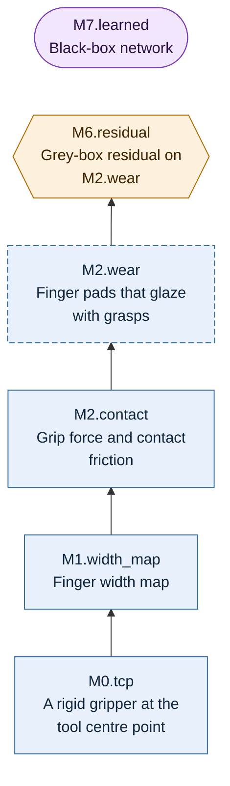

> **Generated file.** Written by [`tools/make_type_docs.py`](../../../../tools/make_type_docs.py) from this folder's [`ladder.py`](ladder.py): edit the ladder, not this file, then run `python tools/make_type_docs.py` from the repository root.

# gripper

An end effector that grasps, on a chain's flange.

**6 rungs** · 5 parameters · 1 aliases · 0 packed names · 0 deployment-only names · folder `end_effectors/gripper/`.

In code: `ladders()["gripper"]` from [`robot_models.ladder`](../../ladder.py). Every type: [docs/TYPES.md](../../../../docs/TYPES.md). Spec: [PEP 0004](../../../../docs/peps/0004-model-ladders-by-type.md).
Projects the notes below name, and what they are: [MuJoCo](../../../../docs/TYPES.md#name-mujoco).

## About

From the docstring of [`ladder.py`](ladder.py):

Spec: PEP 0004 §5.11 and §6.10.

The climb: M0 places a rigid tool at the tool centre point; M1 maps the width command to the finger opening; M2 adds
the grip force and the contact friction that holds an object; M2.wear lets that friction change with grasp cycles. M6
and M7 are the learned rungs every type has.

## The ladder

Read it bottom up: each solid arrow runs from a rung's base to the rung that extends it, and a rung needs everything below it on its own chain (its fallback). Blue box: a physics rung; dashed blue box: a wear rung (a parameter that grows with use); amber hexagon: the grey-box residual (M6) on a physics rung; purple rounded box: the learned net (M7), which extends no model.

## Rungs

Bottom up. *Needs* is what the rung's model cannot run without, new over its base; *reads when stated* is what it uses when a source states it. A rung needs everything its base needs.

| rung | title | base | needs (adds) | reads when stated (optional) | code | equation | references |
| --- | --- | --- | --- | --- | --- | --- | --- |
| `M0.tcp` | A rigid gripper at the tool centre point | — | `tcp_offset` | — | — | `tool = flange · tcp_offset` | [SICILIANO_2009](#ref-siciliano_2009) |
| `M1.width_map` | Finger width map | [`M0.tcp`](#rung-m0-tcp) | `finger_width_map` | — | — | `width = finger_width_map(command)` | [PRATTICHIZZO_2016](#ref-prattichizzo_2016) |
| `M2.contact` | Grip force and contact friction | [`M1.width_map`](#rung-m1-width_map) | `grip_force_map`, `contact_friction` | — | — | `force = grip_force_map(command, width), each pad's normal force; the object holds while, at each contact, \|tangential\| ≤ contact_friction·force (two pads hold about twice one pad's)` | [PRATTICHIZZO_2016](#ref-prattichizzo_2016), [MUJOCO_CONTACT](#ref-mujoco_contact) |
| `M2.wear` | Finger pads that glaze with grasps wears `contact_friction`: see [Wear](#wear) | [`M2.contact`](#rung-m2-contact) | `contact_friction_change` | — | — | `contact_friction(n) = contact_friction + contact_friction_change·n, n the grasp cycles so far` | [ARCHARD_1953](#ref-archard_1953), [LU_MEEKER_1993](#ref-lu_meeker_1993) |
| `M6.residual` | Grey-box residual on M2.wear | [`M2.wear`](#rung-m2-wear) | — | — | — | `M2.wear + an MLP residual width from 3 samples of width command, measured width and finger current` | [NGUYEN_TUONG_2010](#ref-nguyen_tuong_2010) |
| `M7.learned` | Black-box network | — | — | — | — | `an MLP over 5 samples of width command, width and finger current → finger force` | [HWANGBO_2019](#ref-hwangbo_2019) |

## Wear

Which parameter grows with use, with what, by which law, at which rate.

| rung | parameter that wears | grows with | law | rate |
| --- | --- | --- | --- | --- |
| [`M2.wear`](#rung-m2-wear) | [`contact_friction`](#param-contact_friction) | grasp cycles (cycle) | linear: `p(u) = p0 + k·u` | [`contact_friction_change`](#param-contact_friction_change) |

## Vocabulary

Every parameter the ladder holds, by the rung that first reads it. — as a unit: dimensionless (a ratio or a count).

| parameter | SI unit | shape | definition | first read on |
| --- | --- | --- | --- | --- |
| `tcp_offset` | m | pose | The tool centre point's offset from the flange the gripper mounts on. | [`M0.tcp`](#rung-m0-tcp) |
| `finger_width_map` | m | map | Finger opening as a function of the width command. | [`M1.width_map`](#rung-m1-width_map) |
| `grip_force_map` | N | map | The normal force each finger pad presses the object with, as a function of the command and the width: what a gauge squeezed between two jaws reads. A datasheet's gripping force summed over the jaws is twice it on a two-jaw gripper. | [`M2.contact`](#rung-m2-contact) |
| `contact_friction` | — | scalar | Coefficient of friction between the finger pads and the object. | [`M2.contact`](#rung-m2-contact) |
| `contact_friction_change` | 1/cycle | scalar | How much contact_friction changes per grasp cycle (pad wear and glazing). | [`M2.wear`](#rung-m2-wear) |

## Aliases

Other names a source uses for one of these parameters. A note says how it differs when it is not the same quantity one for one. The unit is the one the source writes its values in; *(canonical)* after it marks an alias stored with no unit of its own, which robot_models reads as the canonical parameter's SI unit, shown here spelled out. A note can still qualify that unit.

| alias | canonical | unit | note |
| --- | --- | --- | --- |
| `contact_friction_change_per_cycle` | [`contact_friction_change`](#param-contact_friction_change) | 1/cycle *(canonical)* |   |

## Packed names

Names for one array that carries several of these parameters; never read as one parameter.

None.

## Deployment-only names

Names some model reads that are not the type's own: a deployment sets them, or the mount gives them.

None.

## References

The works the rungs cite, by their names in [`robot_models.references`](../../references.py).

- **ARCHARD_1953**: Archard (1953). Contact and rubbing of flat surfaces. Journal of Applied Physics. [doi:10.1063/1.1721448](https://doi.org/10.1063/1.1721448). What the rung uses: wear volume grows with the load carried times the distance slid. Cited by [`M2.wear`](#rung-m2-wear).
- **HWANGBO_2019**: Hwangbo, Lee, Dosovitskiy, Bellicoso, Tsounis, Koltun, Hutter (2019). Learning agile and dynamic motor skills for legged robots. Science Robotics. [doi:10.1126/scirobotics.aau5872](https://doi.org/10.1126/scirobotics.aau5872). What the rung uses: ANYmal's actuator net: an MLP over position error and velocity at t, t − 10 ms, t − 20 ms, 3 × 32 softsign (arXiv:1901.08652). Cited by [`M7.learned`](#rung-m7-learned).
- **LU_MEEKER_1993**: Lu, Meeker (1993). Using degradation measures to estimate a time-to-failure distribution. Technometrics. [doi:10.1080/00401706.1993.10485038](https://doi.org/10.1080/00401706.1993.10485038). What the rung uses: a degradation path in usage, linear the simplest, crossing a failure threshold. Cited by [`M2.wear`](#rung-m2-wear).
- **MUJOCO_CONTACT**: MuJoCo (2026). Computation: the contact model. [https://mujoco.readthedocs.io/en/stable/computation/index.html](https://mujoco.readthedocs.io/en/stable/computation/index.html) (doc). What the rung uses: soft contact with friction cones, what the twin's grasp runs on. Cited by [`M2.contact`](#rung-m2-contact).
- **NGUYEN_TUONG_2010**: Nguyen-Tuong, Peters (2010). Using model knowledge for learning inverse dynamics. IEEE International Conference on Robotics and Automation. [doi:10.1109/ROBOT.2010.5509858](https://doi.org/10.1109/ROBOT.2010.5509858). What the rung uses: a physics model plus a learned residual. Cited by [`M6.residual`](#rung-m6-residual).
- **PRATTICHIZZO_2016**: Prattichizzo, Trinkle (2016). Grasping. In Springer Handbook of Robotics, 2nd ed. Springer. [doi:10.1007/978-3-319-32552-1_38](https://doi.org/10.1007/978-3-319-32552-1_38) (chapter). What the rung uses: contact, friction cones and grasp force. Cited by [`M1.width_map`](#rung-m1-width_map), [`M2.contact`](#rung-m2-contact).
- **SICILIANO_2009**: Siciliano, Sciavicco, Villani, Oriolo (2009). Robotics: Modelling, Planning and Control. Springer. [doi:10.1007/978-1-84628-642-1](https://doi.org/10.1007/978-1-84628-642-1) (book). What the rung uses: rigid-body joint dynamics and reflected inertia. Cited by [`M0.tcp`](#rung-m0-tcp).
