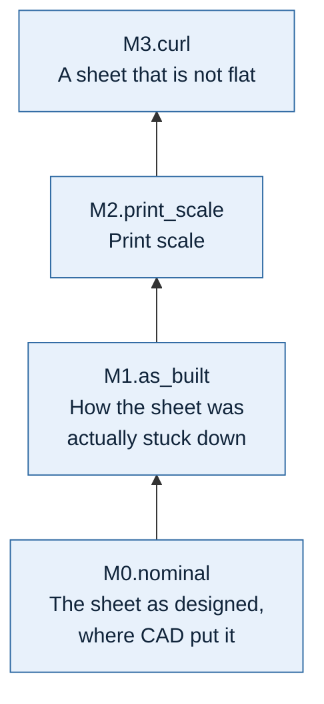

> **Generated file.** Written by [`tools/make_type_docs.py`](../../../../tools/make_type_docs.py) from this folder's [`ladder.py`](ladder.py): edit the ladder, not this file, then run `python tools/make_type_docs.py` from the repository root.

# aruco_marker

A printed sheet carrying one or more ArUco markers rigidly.

**4 rungs** · 8 parameters · 3 aliases · 0 packed names · 0 deployment-only names · folder `markers/aruco_marker/`.

In code: `ladders()["aruco_marker"]` from [`robot_models.ladder`](../../ladder.py). Every type: [docs/TYPES.md](../../../../docs/TYPES.md). Spec: [PEP 0004](../../../../docs/peps/0004-model-ladders-by-type.md).

## About

From the docstring of [`ladder.py`](ladder.py):

The ladder places the sheet's marker corners in the world. M0 reads the sheet as CAD designed it, M1 adds how it was
actually stuck down, M2 how far the print is from its designed size, and M3 that the sheet is not flat.

Spec: PEP 0004 §5.13 and §6.12.

## The ladder

Read it bottom up: each solid arrow runs from a rung's base to the rung that extends it, and a rung needs everything below it on its own chain (its fallback). Blue box: a physics rung.

## Rungs

Bottom up. *Needs* is what the rung's model cannot run without, new over its base; *reads when stated* is what it uses when a source states it. A rung needs everything its base needs.

| rung | title | base | needs (adds) | reads when stated (optional) | code | equation | references |
| --- | --- | --- | --- | --- | --- | --- | --- |
| `M0.nominal` | The sheet as designed, where CAD put it | — | `dictionary`, `marker_ids`, `marker_length`, `layout`, `pose_on_link` | — | — | `X_corner = FK(q) · pose_on_link · layout_corner` | [ZHANG_2000](#ref-zhang_2000), [GARRIDO_2014](#ref-garrido_2014) |
| `M1.as_built` | How the sheet was actually stuck down | [`M0.nominal`](#rung-m0-nominal) | `as_built_offset` | — | — | `X_corner = FK(q) · pose_on_link · as_built_offset · layout_corner` | [TRIGGS_2000](#ref-triggs_2000) |
| `M2.print_scale` | Print scale | [`M1.as_built`](#rung-m1-as_built) | `print_scale` | — | — | `X_corner = FK(q) · pose_on_link · as_built_offset · (print_scale · layout_corner)` | [STROBL_2011](#ref-strobl_2011) |
| `M3.curl` | A sheet that is not flat | [`M2.print_scale`](#rung-m2-print_scale) | `flatness` | — | — | `layout_corner z = flatness·(2x/L)² (a bow across the sheet's length L)` | [STROBL_2011](#ref-strobl_2011) |

## Vocabulary

Every parameter the ladder holds, by the rung that first reads it. — as a unit: dimensionless (a ratio or a count).

| parameter | SI unit | shape | definition | first read on |
| --- | --- | --- | --- | --- |
| `dictionary` | — | text | The ArUco dictionary the sheet is printed in. | [`M0.nominal`](#rung-m0-nominal) |
| `marker_ids` | — | list | The marker ids the sheet carries. | [`M0.nominal`](#rung-m0-nominal) |
| `marker_length` | m | scalar | Side of each marker's black square. | [`M0.nominal`](#rung-m0-nominal) |
| `layout` | m | map | Each marker's corners in the sheet's own frame. | [`M0.nominal`](#rung-m0-nominal) |
| `pose_on_link` | m, rad | pose | The sheet's frame on the link it is stuck to. | [`M0.nominal`](#rung-m0-nominal) |
| `as_built_offset` | m, rad | pose | How the sheet was actually stuck down: its offset from pose_on_link. | [`M1.as_built`](#rung-m1-as_built) |
| `print_scale` | — | scalar | Printed size over designed size. | [`M2.print_scale`](#rung-m2-print_scale) |
| `flatness` | m | scalar | The sheet's out-of-plane bow at its far end. | [`M3.curl`](#rung-m3-curl) |

## Aliases

Other names a source uses for one of these parameters. A note says how it differs when it is not the same quantity one for one. The unit is the one the source writes its values in; *(canonical)* after it marks an alias stored with no unit of its own, which robot_models reads as the canonical parameter's SI unit, shown here spelled out. A note can still qualify that unit.

| alias | canonical | unit | note |
| --- | --- | --- | --- |
| `flatness_m` | [`flatness`](#param-flatness) | m *(canonical)* |   |
| `layout_m` | [`layout`](#param-layout) | m *(canonical)* |   |
| `marker_length_m` | [`marker_length`](#param-marker_length) | m *(canonical)* |   |

## Packed names

Names for one array that carries several of these parameters; never read as one parameter.

None.

## Deployment-only names

Names some model reads that are not the type's own: a deployment sets them, or the mount gives them.

None.

## References

The works the rungs cite, by their names in [`robot_models.references`](../../references.py).

- **GARRIDO_2014**: Garrido-Jurado, Muñoz-Salinas, Madrid-Cuevas, Marín-Jiménez (2014). Automatic generation and detection of highly reliable fiducial markers under occlusion. Pattern Recognition 47(6):2280-2292. no stable URL or DOI. What the rung uses: the ArUco dictionaries, their ids and the detector OpenCV ships. Cited by [`M0.nominal`](#rung-m0-nominal).
- **STROBL_2011**: Strobl, Hirzinger (2011). More accurate pinhole camera calibration with imperfect planar target. IEEE International Conference on Computer Vision Workshops. no stable URL or DOI. What the rung uses: a target's own geometry (scale, flatness) fitted with the camera. Cited by [`M2.print_scale`](#rung-m2-print_scale), [`M3.curl`](#rung-m3-curl).
- **TRIGGS_2000**: Triggs, McLauchlan, Hartley, Fitzgibbon (2000). Bundle adjustment: a modern synthesis. Vision Algorithms: Theory and Practice, LNCS 1883, Springer. no stable URL or DOI (chapter). What the rung uses: robust bundle adjustment, priors and the gauge (one sticker held at CAD). Cited by [`M1.as_built`](#rung-m1-as_built).
- **ZHANG_2000**: Zhang (2000). A flexible new technique for camera calibration. IEEE Transactions on Pattern Analysis and Machine Intelligence. [doi:10.1109/34.888718](https://doi.org/10.1109/34.888718). What the rung uses: pinhole intrinsics from a planar target in several poses. Cited by [`M0.nominal`](#rung-m0-nominal).
