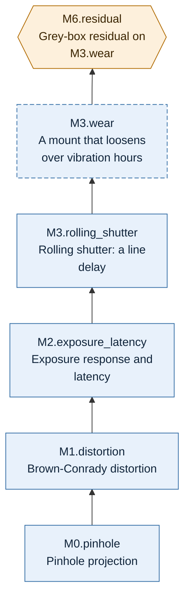

> **Generated file.** Written by [`tools/make_type_docs.py`](../../../../tools/make_type_docs.py) from this folder's [`ladder.py`](ladder.py): edit the ladder, not this file, then run `python tools/make_type_docs.py` from the repository root.

# camera

A frame camera's colour image: projection, distortion, exposure.

**6 rungs** · 8 parameters · 5 aliases · 0 packed names · 0 deployment-only names · folder `sensors/camera/`.

In code: `ladders()["camera"]` from [`robot_models.ladder`](../../ladder.py). Every type: [docs/TYPES.md](../../../../docs/TYPES.md). Spec: [PEP 0004](../../../../docs/peps/0004-model-ladders-by-type.md).

## About

From the docstring of [`ladder.py`](ladder.py), less a paragraph on the order that file reads in (this page shows the ladder, then the rungs, then the names):

Spec: PEP 0004 §5.7 and §6.6.

The ladder climbs from the ideal pinhole (M0) through the lens (M1), the sensor's light response and the frame's delay
(M2), a rolling shutter (M3) and a mount that loosens with vibration (M3.wear), to a grey-box correction of every pixel's
ray (M6). There is no black-box rung: every rung stays a geometric pixel-to-ray model that a calibration target can
measure, and a learned image-to-image black box gives no rays to check.

## The ladder

Read it bottom up: each solid arrow runs from a rung's base to the rung that extends it, and a rung needs everything below it on its own chain (its fallback). Blue box: a physics rung; dashed blue box: a wear rung (a parameter that grows with use); amber hexagon: the grey-box residual (M6) on a physics rung.

## Rungs

Bottom up. *Needs* is what the rung's model cannot run without, new over its base; *reads when stated* is what it uses when a source states it. A rung needs everything its base needs.

| rung | title | base | needs (adds) | reads when stated (optional) | code | equation | references |
| --- | --- | --- | --- | --- | --- | --- | --- |
| `M0.pinhole` | Pinhole projection | — | `fx_fy`, `cx_cy`, `extrinsics` | — | — | `p = K [R \| t] X, K from fx_fy and cx_cy, [R \| t] the extrinsics` | [ZHANG_2000](#ref-zhang_2000) |
| `M1.distortion` | Brown-Conrady distortion | [`M0.pinhole`](#rung-m0-pinhole) | `distortion` | — | — | `radial (k1, k2, k3) and tangential (p1, p2) distortion of the projected point` | [ZHANG_2000](#ref-zhang_2000), [BROWN_1966](#ref-brown_1966), [HEIKKILA_1997](#ref-heikkila_1997) |
| `M2.exposure_latency` | Exposure response and latency | [`M1.distortion`](#rung-m1-distortion) | `exposure_response`, `latency` | — | — | `DN = exposure_response·illuminance·exposure time; the frame arrives latency after exposure` | [ZHANG_2000](#ref-zhang_2000) |
| `M3.rolling_shutter` | Rolling shutter: a line delay | [`M2.exposure_latency`](#rung-m2-exposure_latency) | `line_delay` | — | — | `row v exposed at t0 + v·line_delay` | [OTH_2013](#ref-oth_2013), [MEINGAST_2005](#ref-meingast_2005) |
| `M3.wear` | A mount that loosens over vibration hours wears `extrinsics`: see [Wear](#wear) | [`M3.rolling_shutter`](#rung-m3-rolling_shutter) | `extrinsic_drift` | — | — | `translation offset(h) = e + extrinsic_drift·√h` | [JUNKER_1969](#ref-junker_1969), [WHITMORE_1995](#ref-whitmore_1995) |
| `M6.residual` | Grey-box residual on M3.wear | [`M3.wear`](#rung-m3-wear) | — | — | — | `M3.wear + a B-spline grid of ray offsets over the pixel (u, v)` | [SCHOPS_2020](#ref-schops_2020) |

## Wear

Which parameter grows with use, with what, by which law, at which rate.

| rung | parameter that wears | grows with | law | rate |
| --- | --- | --- | --- | --- |
| [`M3.wear`](#rung-m3-wear) | [`extrinsics`](#param-extrinsics) | vibration hours (h) | sqrt: `p(u) = p0 + k·√u` | [`extrinsic_drift`](#param-extrinsic_drift) |

## Vocabulary

Every parameter the ladder holds, by the rung that first reads it. — as a unit: dimensionless (a ratio or a count).

| parameter | SI unit | shape | definition | first read on |
| --- | --- | --- | --- | --- |
| `fx_fy` | px | pair | Focal lengths in pixels, (fx, fy). | [`M0.pinhole`](#rung-m0-pinhole) |
| `cx_cy` | px | pair | Principal point in pixels, (cx, cy). | [`M0.pinhole`](#rung-m0-pinhole) |
| `extrinsics` | m, rad | pose | The camera's pose in the frame it is calibrated against. | [`M0.pinhole`](#rung-m0-pinhole) |
| `distortion` | — | list | Brown-Conrady lens distortion coefficients, radial and tangential. | [`M1.distortion`](#rung-m1-distortion) |
| `exposure_response` | DN/(lx·s) | scalar | Pixel value per unit of light exposure: the sensor's response. | [`M2.exposure_latency`](#rung-m2-exposure_latency) |
| `latency` | s | scalar | Delay from exposure to the frame's arrival. | [`M2.exposure_latency`](#rung-m2-exposure_latency) |
| `line_delay` | s | scalar | Rolling shutter: the time between the exposures of successive rows. | [`M3.rolling_shutter`](#rung-m3-rolling_shutter) |
| `extrinsic_drift` | m/√h | scalar | How fast the extrinsics' translation drifts with the square root of vibration hours (a loosening mount); no source states a rotation rate. | [`M3.wear`](#rung-m3-wear) |

## Aliases

Other names a source uses for one of these parameters. A note says how it differs when it is not the same quantity one for one. The unit is the one the source writes its values in; *(canonical)* after it marks an alias stored with no unit of its own, which robot_models reads as the canonical parameter's SI unit, shown here spelled out. A note can still qualify that unit.

| alias | canonical | unit | note |
| --- | --- | --- | --- |
| `camera_latency_ms` | [`latency`](#param-latency) | ms |   |
| `camera_latency_s` | [`latency`](#param-latency) | s *(canonical)* |   |
| `extrinsic_drift_mm_per_sqrt_h` | [`extrinsic_drift`](#param-extrinsic_drift) | mm/√h |   |
| `latency_s` | [`latency`](#param-latency) | s *(canonical)* |   |
| `line_delay_s` | [`line_delay`](#param-line_delay) | s *(canonical)* |   |

## Packed names

Names for one array that carries several of these parameters; never read as one parameter.

None.

## Deployment-only names

Names some model reads that are not the type's own: a deployment sets them, or the mount gives them.

None.

## References

The works the rungs cite, by their names in [`robot_models.references`](../../references.py).

- **BROWN_1966**: Brown (1966). Decentering distortion of lenses. Photogrammetric Engineering. no stable URL or DOI. What the rung uses: the radial and tangential (Brown-Conrady) distortion model; no stable URL. Cited by [`M1.distortion`](#rung-m1-distortion).
- **HEIKKILA_1997**: Heikkilä, Silvén (1997). A four-step camera calibration procedure with implicit image correction. IEEE Conference on Computer Vision and Pattern Recognition. [doi:10.1109/CVPR.1997.609468](https://doi.org/10.1109/CVPR.1997.609468). What the rung uses: pinhole + radial and tangential distortion fitted together. Cited by [`M1.distortion`](#rung-m1-distortion).
- **JUNKER_1969**: Junker (1969). New criteria for self-loosening of fasteners under vibration. SAE Technical Paper. [doi:10.4271/690055](https://doi.org/10.4271/690055). What the rung uses: a mount loosening under transverse vibration. Cited by [`M3.wear`](#rung-m3-wear).
- **MEINGAST_2005**: Meingast, Geyer, Sastry (2005). Geometric models of rolling-shutter cameras. arXiv:cs/0503076. [https://arxiv.org/abs/cs/0503076](https://arxiv.org/abs/cs/0503076) (preprint). What the rung uses: each row exposed at its own time. Cited by [`M3.rolling_shutter`](#rung-m3-rolling_shutter).
- **OTH_2013**: Oth, Furgale, Kneip, Siegwart (2013). Rolling shutter camera calibration. IEEE Conference on Computer Vision and Pattern Recognition. [doi:10.1109/CVPR.2013.179](https://doi.org/10.1109/CVPR.2013.179). What the rung uses: the line delay of a rolling shutter, calibrated. Cited by [`M3.rolling_shutter`](#rung-m3-rolling_shutter).
- **SCHOPS_2020**: Schöps, Larsson, Pollefeys, Sattler (2020). Why having 10,000 parameters in your camera model is better than twelve. IEEE/CVF Conference on Computer Vision and Pattern Recognition. [doi:10.1109/CVPR42600.2020.00261](https://doi.org/10.1109/CVPR42600.2020.00261). What the rung uses: a dense B-spline generic camera model above the parametric one. Cited by [`M6.residual`](#rung-m6-residual).
- **WHITMORE_1995**: Whitmore (1995). Estimating degradation by a Wiener diffusion process subject to measurement error. Lifetime Data Analysis. [doi:10.1007/BF00985762](https://doi.org/10.1007/BF00985762). What the rung uses: diffusive drift: its expected size grows as the square root of time. Cited by [`M3.wear`](#rung-m3-wear).
- **ZHANG_2000**: Zhang (2000). A flexible new technique for camera calibration. IEEE Transactions on Pattern Analysis and Machine Intelligence. [doi:10.1109/34.888718](https://doi.org/10.1109/34.888718). What the rung uses: pinhole intrinsics from a planar target in several poses. Cited by [`M0.pinhole`](#rung-m0-pinhole), [`M1.distortion`](#rung-m1-distortion), [`M2.exposure_latency`](#rung-m2-exposure_latency).
