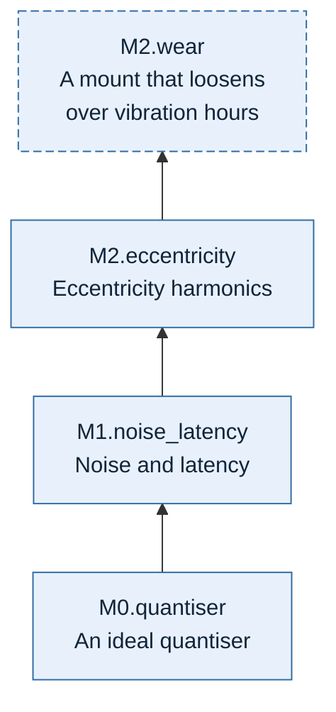

> **Generated file.** Written by [`tools/make_type_docs.py`](../../../../tools/make_type_docs.py) from this folder's [`ladder.py`](ladder.py): edit the ladder, not this file, then run `python tools/make_type_docs.py` from the repository root.

# encoder

An angle sensor on a shaft, such as a drive's rotor encoder.

**4 rungs** · 5 parameters · 6 aliases · 0 packed names · 0 deployment-only names · folder `sensors/encoder/`.

In code: `ladders()["encoder"]` from [`robot_models.ladder`](../../ladder.py). Every type: [docs/TYPES.md](../../../../docs/TYPES.md). Spec: [PEP 0004](../../../../docs/peps/0004-model-ladders-by-type.md).

## About

From the docstring of [`ladder.py`](ladder.py):

The reading is the shaft's angle, quantised to counts_per_rev (M0), with noise and a delay (M1), plus an angle error
that repeats with the shaft angle (M2.eccentricity), which grows over vibration hours as the mount loosens (M2.wear).

Spec: PEP 0004 §5.6 and §6.5.

## The ladder

Read it bottom up: each solid arrow runs from a rung's base to the rung that extends it, and a rung needs everything below it on its own chain (its fallback). Blue box: a physics rung; dashed blue box: a wear rung (a parameter that grows with use).

## Rungs

Bottom up. *Needs* is what the rung's model cannot run without, new over its base; *reads when stated* is what it uses when a source states it. A rung needs everything its base needs.

| rung | title | base | needs (adds) | reads when stated (optional) | code | equation | references |
| --- | --- | --- | --- | --- | --- | --- | --- |
| `M0.quantiser` | An ideal quantiser | — | `counts_per_rev` | — | — | `q_reported = round(q/lsb)·lsb, lsb = 2π/counts_per_rev` | [WIDROW_2008](#ref-widrow_2008) |
| `M1.noise_latency` | Noise and latency | [`M0.quantiser`](#rung-m0-quantiser) | `noise_sigma`, `latency` | — | — | `q_reported(t) = round((q(t − latency) + n)/lsb)·lsb, n ~ N(0, noise_sigma²)` | [MERRY_2010](#ref-merry_2010) |
| `M2.eccentricity` | Eccentricity harmonics | [`M1.noise_latency`](#rung-m1-noise_latency) | `eccentricity_harmonics` | — | — | `q_reported = round((q + e(q) + n)/lsb)·lsb, delayed; e(q) the eccentricity harmonics` | [ZHAO_2024](#ref-zhao_2024) |
| `M2.wear` | A mount that loosens over vibration hours wears `eccentricity_harmonics`: see [Wear](#wear) | [`M2.eccentricity`](#rung-m2-eccentricity) | `eccentricity_growth` | — | — | `e(h) = e + eccentricity_growth·√h` | [JUNKER_1969](#ref-junker_1969), [WHITMORE_1995](#ref-whitmore_1995) |

## Wear

Which parameter grows with use, with what, by which law, at which rate.

| rung | parameter that wears | grows with | law | rate |
| --- | --- | --- | --- | --- |
| [`M2.wear`](#rung-m2-wear) | [`eccentricity_harmonics`](#param-eccentricity_harmonics) | vibration hours (h) | sqrt: `p(u) = p0 + k·√u` | [`eccentricity_growth`](#param-eccentricity_growth) |

## Vocabulary

Every parameter the ladder holds, by the rung that first reads it. — as a unit: dimensionless (a ratio or a count).

| parameter | SI unit | shape | definition | first read on |
| --- | --- | --- | --- | --- |
| `counts_per_rev` | 1/rev | integer | Distinct readings per revolution of the shaft it reads: its quantisation. | [`M0.quantiser`](#rung-m0-quantiser) |
| `noise_sigma` | rad | scalar | Standard deviation of the reading's noise at standstill. | [`M1.noise_latency`](#rung-m1-noise_latency) |
| `latency` | s | scalar | Delay from the shaft's angle to the reading that reports it. | [`M1.noise_latency`](#rung-m1-noise_latency) |
| `eccentricity_harmonics` | rad | list | Angle error periodic in the shaft angle (an eccentric magnet or disc), a list of (harmonic, amplitude, phase). | [`M2.eccentricity`](#rung-m2-eccentricity) |
| `eccentricity_growth` | rad/√h | scalar | How fast the eccentricity grows with the square root of vibration hours (a loosening mount). | [`M2.wear`](#rung-m2-wear) |

## Aliases

Other names a source uses for one of these parameters. A note says how it differs when it is not the same quantity one for one. The unit is the one the source writes its values in; *(canonical)* after it marks an alias stored with no unit of its own, which robot_models reads as the canonical parameter's SI unit, shown here spelled out. A note can still qualify that unit.

| alias | canonical | unit | note |
| --- | --- | --- | --- |
| `eccentricity_growth_mrad_per_sqrt_h` | [`eccentricity_growth`](#param-eccentricity_growth) | mrad/√h |   |
| `encoder_bits` | [`counts_per_rev`](#param-counts_per_rev) | 1/rev *(canonical)* | Bits: 2^bits counts per revolution. |
| `encoder_counts` | [`counts_per_rev`](#param-counts_per_rev) | 1/rev *(canonical)* |   |
| `encoder_counts_per_rev` | [`counts_per_rev`](#param-counts_per_rev) | 1/rev *(canonical)* |   |
| `encoder_lines` | [`counts_per_rev`](#param-counts_per_rev) | 1/rev *(canonical)* | Lines: a quadrature encoder counts 4 × lines per revolution. |
| `latency_s` | [`latency`](#param-latency) | s *(canonical)* |   |

## Packed names

Names for one array that carries several of these parameters; never read as one parameter.

None.

## Deployment-only names

Names some model reads that are not the type's own: a deployment sets them, or the mount gives them.

None.

## References

The works the rungs cite, by their names in [`robot_models.references`](../../references.py).

- **JUNKER_1969**: Junker (1969). New criteria for self-loosening of fasteners under vibration. SAE Technical Paper. [doi:10.4271/690055](https://doi.org/10.4271/690055). What the rung uses: a mount loosening under transverse vibration. Cited by [`M2.wear`](#rung-m2-wear).
- **MERRY_2010**: Merry, van de Molengraft, Steinbuch (2010). Velocity and acceleration estimation for optical incremental encoders. Mechatronics. [doi:10.1016/j.mechatronics.2009.06.010](https://doi.org/10.1016/j.mechatronics.2009.06.010). What the rung uses: encoder noise, quantisation and delay in velocity. Cited by [`M1.noise_latency`](#rung-m1-noise_latency).
- **WHITMORE_1995**: Whitmore (1995). Estimating degradation by a Wiener diffusion process subject to measurement error. Lifetime Data Analysis. [doi:10.1007/BF00985762](https://doi.org/10.1007/BF00985762). What the rung uses: diffusive drift: its expected size grows as the square root of time. Cited by [`M2.wear`](#rung-m2-wear).
- **WIDROW_2008**: Widrow, Kollár (2008). Quantization Noise. Cambridge University Press. [doi:10.1017/CBO9780511754661](https://doi.org/10.1017/CBO9780511754661) (book). What the rung uses: an encoder as a quantiser. Cited by [`M0.quantiser`](#rung-m0-quantiser).
- **ZHAO_2024**: Zhao, Wan, Liang (2024). Automatic compensation system for eccentricity error of absolute optical encoder. Review of Scientific Instruments. [doi:10.1063/5.0211297](https://doi.org/10.1063/5.0211297). What the rung uses: eccentricity as once-per-turn harmonics. Cited by [`M2.eccentricity`](#rung-m2-eccentricity).
