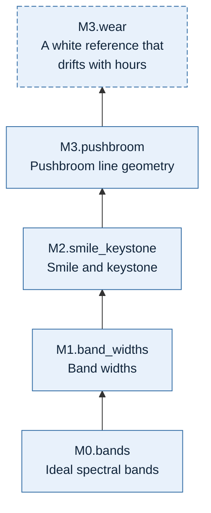

> **Generated file.** Written by [`tools/make_type_docs.py`](../../../../tools/make_type_docs.py) from this folder's [`ladder.py`](ladder.py): edit the ladder, not this file, then run `python tools/make_type_docs.py` from the repository root.

# hyperspectral_camera

A line-scan spectral camera over a belt.

**5 rungs** · 7 parameters · 1 aliases · 1 packed names · 0 deployment-only names · folder `sensors/hyperspectral_camera/`.

In code: `ladders()["hyperspectral_camera"]` from [`robot_models.ladder`](../../ladder.py). Every type: [docs/TYPES.md](../../../../docs/TYPES.md). Spec: [PEP 0004](../../../../docs/peps/0004-model-ladders-by-type.md).
Projects the notes below name, and what they are: [sim2real](../../../../docs/TYPES.md#name-sim2real).

## About

From the docstring of [`ladder.py`](ladder.py):

Each frame is one line of the belt, split into spectral bands; the belt's motion sweeps the lines into a cube. The
ladder starts at the bands and the references that turn counts into reflectance, then adds the optics' distortion, the
sweep geometry, and the white reference's drift over deployment hours.

Spec: PEP 0004 §5.9 and §6.8.

## The ladder

Read it bottom up: each solid arrow runs from a rung's base to the rung that extends it, and a rung needs everything below it on its own chain (its fallback). Blue box: a physics rung; dashed blue box: a wear rung (a parameter that grows with use).

## Rungs

Bottom up. *Needs* is what the rung's model cannot run without, new over its base; *reads when stated* is what it uses when a source states it. A rung needs everything its base needs.

| rung | title | base | needs (adds) | reads when stated (optional) | code | equation | references |
| --- | --- | --- | --- | --- | --- | --- | --- |
| `M0.bands` | Ideal spectral bands | — | `band_centres`, `dark_reference`, `white_reference` | — | — | `R(λ) = (DN − dark_reference)/(white_reference − dark_reference), at each band's band_centres` | [BURGER_2011](#ref-burger_2011) |
| `M1.band_widths` | Band widths | [`M0.bands`](#rung-m0-bands) | `band_fwhm` | — | — | `each band a Gaussian of its band_fwhm about its band_centres` | [BURGER_2011](#ref-burger_2011), [KRUSE_1993](#ref-kruse_1993) |
| `M2.smile_keystone` | Smile and keystone | [`M1.band_widths`](#rung-m1-band_widths) | `smile_keystone_map` | — | — | `the cube resampled through smile_keystone_map, then R(λ) per band` | [MOUROULIS_2000](#ref-mouroulis_2000) |
| `M3.pushbroom` | Pushbroom line geometry | [`M2.smile_keystone`](#rung-m2-smile_keystone) | `line_geometry` | — | — | `a line camera swept by the belt: line k sees the belt at k·(belt distance per line)` | [GUPTA_1997](#ref-gupta_1997) |
| `M3.wear` | A white reference that drifts with hours wears `white_reference`: see [Wear](#wear) | [`M3.pushbroom`](#rung-m3-pushbroom) | `reference_drift` | — | — | `white_reference(h) = white_reference + reference_drift·h; dark_reference stays` | [LU_MEEKER_1993](#ref-lu_meeker_1993) |

## Wear

Which parameter grows with use, with what, by which law, at which rate.

| rung | parameter that wears | grows with | law | rate |
| --- | --- | --- | --- | --- |
| [`M3.wear`](#rung-m3-wear) | [`white_reference`](#param-white_reference) | deployment hours (h) | linear: `p(u) = p0 + k·u` | [`reference_drift`](#param-reference_drift) |

## Vocabulary

Every parameter the ladder holds, by the rung that first reads it. — as a unit: dimensionless (a ratio or a count).

| parameter | SI unit | shape | definition | first read on |
| --- | --- | --- | --- | --- |
| `band_centres` | m | list | Centre wavelength of each spectral band. | [`M0.bands`](#rung-m0-bands) |
| `dark_reference` | DN | map | The dark reference frame (shutter closed): each pixel's and band's counts at zero light. | [`M0.bands`](#rung-m0-bands) |
| `white_reference` | DN | map | The white reference frame: each pixel's and band's counts over a white tile of known reflectance. | [`M0.bands`](#rung-m0-bands) |
| `band_fwhm` | m | list | Full width at half maximum of each band's spectral response. | [`M1.band_widths`](#rung-m1-band_widths) |
| `smile_keystone_map` | px | map | The spectral (smile) and spatial (keystone) distortion map the cube is resampled with. | [`M2.smile_keystone`](#rung-m2-smile_keystone) |
| `line_geometry` | m, rad | pair | The scan line's pose, and the belt distance per line. | [`M3.pushbroom`](#rung-m3-pushbroom) |
| `reference_drift` | DN/h | scalar | How fast the white reference's DN drifts per deployment hour (lamp ageing). The dark reference drifts the other way (dark current) and is not modelled by this rate. | [`M3.wear`](#rung-m3-wear) |

## Aliases

Other names a source uses for one of these parameters. A note says how it differs when it is not the same quantity one for one. The unit is the one the source writes its values in; *(canonical)* after it marks an alias stored with no unit of its own, which robot_models reads as the canonical parameter's SI unit, shown here spelled out. A note can still qualify that unit.

| alias | canonical | unit | note |
| --- | --- | --- | --- |
| `reference_drift_per_h` | [`reference_drift`](#param-reference_drift) | DN/h *(canonical)* |   |

## Packed names

Names for one array that carries several of these parameters; never read as one parameter.

| packed name | carries | order | note |
| --- | --- | --- | --- |
| `dark_white_refs` | [`dark_reference`](#param-dark_reference), [`white_reference`](#param-white_reference) | its full entry order | sim2real's camera_hsi card: (dark, white) as its name reads, both in DN. |

## Deployment-only names

Names some model reads that are not the type's own: a deployment sets them, or the mount gives them.

None.

## References

The works the rungs cite, by their names in [`robot_models.references`](../../references.py).

- **BURGER_2011**: Burger, Gowen (2011). Data handling in hyperspectral image analysis. Chemometrics and Intelligent Laboratory Systems. [doi:10.1016/j.chemolab.2011.04.001](https://doi.org/10.1016/j.chemolab.2011.04.001). What the rung uses: dark and white reference reflectance calibration. Cited by [`M0.bands`](#rung-m0-bands), [`M1.band_widths`](#rung-m1-band_widths).
- **GUPTA_1997**: Gupta, Hartley (1997). Linear pushbroom cameras. IEEE Transactions on Pattern Analysis and Machine Intelligence. [doi:10.1109/34.615446](https://doi.org/10.1109/34.615446). What the rung uses: the line-scan (pushbroom) camera's geometry. Cited by [`M3.pushbroom`](#rung-m3-pushbroom).
- **KRUSE_1993**: Kruse, Lefkoff, Boardman, Heidebrecht, Shapiro, Barloon, Goetz (1993). The spectral image processing system (SIPS)—interactive visualization and analysis of imaging spectrometer data. Remote Sensing of Environment. [doi:10.1016/0034-4257(93)90013-N](https://doi.org/10.1016/0034-4257%2893%2990013-N). What the rung uses: the spectral angle. Cited by [`M1.band_widths`](#rung-m1-band_widths).
- **LU_MEEKER_1993**: Lu, Meeker (1993). Using degradation measures to estimate a time-to-failure distribution. Technometrics. [doi:10.1080/00401706.1993.10485038](https://doi.org/10.1080/00401706.1993.10485038). What the rung uses: a degradation path in usage, linear the simplest, crossing a failure threshold. Cited by [`M3.wear`](#rung-m3-wear).
- **MOUROULIS_2000**: Mouroulis, Green, Chrien (2000). Design of pushbroom imaging spectrometers for optimum recovery of spectroscopic and spatial information. Applied Optics. [doi:10.1364/AO.39.002210](https://doi.org/10.1364/AO.39.002210). What the rung uses: smile and keystone. Cited by [`M2.smile_keystone`](#rung-m2-smile_keystone).
