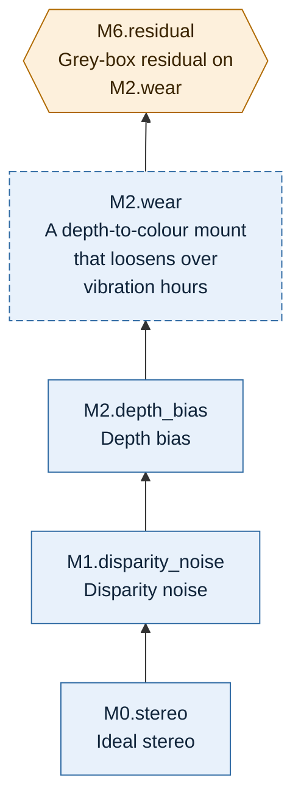

> **Generated file.** Written by [`tools/make_type_docs.py`](../../../../tools/make_type_docs.py) from this folder's [`ladder.py`](ladder.py): edit the ladder, not this file, then run `python tools/make_type_docs.py` from the repository root.

# depth_camera

A stereo depth camera: depth on top of a colour stream.

**5 rungs** · 6 parameters · 2 aliases · 0 packed names · 0 deployment-only names · folder `sensors/rgbd/`.

In code: `ladders()["depth_camera"]` from [`robot_models.ladder`](../../ladder.py). Every type: [docs/TYPES.md](../../../../docs/TYPES.md). Spec: [PEP 0004](../../../../docs/peps/0004-model-ladders-by-type.md).
Projects the notes below name, and what they are: [sim2real](../../../../docs/TYPES.md#name-sim2real).

## About

From the docstring of [`ladder.py`](ladder.py):

Spec: PEP 0004 §5.8 and §6.7.

    z = f·baseline/d                    # M0: depth from disparity d, f the stereo pair's rectified focal length (px)
    σ_z = z²·subpixel_sigma/(f·baseline)  # M1: the matcher's subpixel noise, growing with z²
    z_true = z + b(u, v, z)             # M2: a bias that grows with depth and varies across the image

The colour stream itself is the camera type's (`sensors/camera`), so this ladder lists only what depth adds. Depth is
triangulated with the stereo imagers' rectified focal length f in pixels (on a typical RGBD unit, the IR pair); the colour
camera only receives depth after the `depth_to_color` transform. The vocabulary does not name f yet: a spec gap to raise
against PEP 0004. sim2real's `camera_rgbd` card maps one to one onto all five rungs (PEP 0004's rung map).

## The ladder

Read it bottom up: each solid arrow runs from a rung's base to the rung that extends it, and a rung needs everything below it on its own chain (its fallback). Blue box: a physics rung; dashed blue box: a wear rung (a parameter that grows with use); amber hexagon: the grey-box residual (M6) on a physics rung.

## Rungs

Bottom up. *Needs* is what the rung's model cannot run without, new over its base; *reads when stated* is what it uses when a source states it. A rung needs everything its base needs.

| rung | title | base | needs (adds) | reads when stated (optional) | code | equation | references |
| --- | --- | --- | --- | --- | --- | --- | --- |
| `M0.stereo` | Ideal stereo | — | `baseline`, `depth_scale`, `depth_to_color` | — | — | `z = f·baseline/d, scaled by depth_scale` | [KHOSHELHAM_2012](#ref-khoshelham_2012) |
| `M1.disparity_noise` | Disparity noise | [`M0.stereo`](#rung-m0-stereo) | `subpixel_sigma` | — | — | `σ_z = z²·subpixel_sigma/(f·baseline)` | [KHOSHELHAM_2012](#ref-khoshelham_2012) |
| `M2.depth_bias` | Depth bias | [`M1.disparity_noise`](#rung-m1-disparity_noise) | `depth_bias_coeffs` | — | — | `z_true = z + b(u, v, z), b from depth_bias_coeffs` | [HERRERA_2012](#ref-herrera_2012) |
| `M2.wear` | A depth-to-colour mount that loosens over vibration hours wears `depth_to_color`: see [Wear](#wear) | [`M2.depth_bias`](#rung-m2-depth_bias) | `depth_to_color_drift` | — | — | `translation offset(h) = e + depth_to_color_drift·√h, e the depth_to_color translation` | [JUNKER_1969](#ref-junker_1969), [WHITMORE_1995](#ref-whitmore_1995) |
| `M6.residual` | Grey-box residual on M2.wear | [`M2.wear`](#rung-m2-wear) | — | — | — | `M2.wear + a B-spline grid of depth corrections over (u, v, measured depth)` | [SCHOPS_2020](#ref-schops_2020), [HERRERA_2012](#ref-herrera_2012) |

## Wear

Which parameter grows with use, with what, by which law, at which rate.

| rung | parameter that wears | grows with | law | rate |
| --- | --- | --- | --- | --- |
| [`M2.wear`](#rung-m2-wear) | [`depth_to_color`](#param-depth_to_color) | vibration hours (h) | sqrt: `p(u) = p0 + k·√u` | [`depth_to_color_drift`](#param-depth_to_color_drift) |

## Vocabulary

Every parameter the ladder holds, by the rung that first reads it. — as a unit: dimensionless (a ratio or a count).

| parameter | SI unit | shape | definition | first read on |
| --- | --- | --- | --- | --- |
| `baseline` | m | scalar | Distance between the stereo pair's optical centres. | [`M0.stereo`](#rung-m0-stereo) |
| `depth_scale` | m | scalar | Metres per unit of the depth image. | [`M0.stereo`](#rung-m0-stereo) |
| `depth_to_color` | m, rad | pose | The depth frame's pose in the colour camera's frame. | [`M0.stereo`](#rung-m0-stereo) |
| `subpixel_sigma` | px | scalar | Standard deviation of the disparity: the stereo matcher's subpixel noise. | [`M1.disparity_noise`](#rung-m1-disparity_noise) |
| `depth_bias_coeffs` | m | list | Coefficients of a depth bias that grows with depth and varies across the image. | [`M2.depth_bias`](#rung-m2-depth_bias) |
| `depth_to_color_drift` | m/√h | scalar | How fast depth_to_color's translation drifts with the square root of vibration hours; no source states a rotation rate. | [`M2.wear`](#rung-m2-wear) |

## Aliases

Other names a source uses for one of these parameters. A note says how it differs when it is not the same quantity one for one. The unit is the one the source writes its values in; *(canonical)* after it marks an alias stored with no unit of its own, which robot_models reads as the canonical parameter's SI unit, shown here spelled out. A note can still qualify that unit.

| alias | canonical | unit | note |
| --- | --- | --- | --- |
| `baseline_m` | [`baseline`](#param-baseline) | m *(canonical)* |   |
| `depth_to_color_drift_mm_per_sqrt_h` | [`depth_to_color_drift`](#param-depth_to_color_drift) | mm/√h |   |

## Packed names

Names for one array that carries several of these parameters; never read as one parameter.

None.

## Deployment-only names

Names some model reads that are not the type's own: a deployment sets them, or the mount gives them.

None.

## References

The works the rungs cite, by their names in [`robot_models.references`](../../references.py).

- **HERRERA_2012**: Herrera C., Kannala, Heikkilä (2012). Joint depth and color camera calibration with distortion correction. IEEE Transactions on Pattern Analysis and Machine Intelligence. [doi:10.1109/TPAMI.2012.125](https://doi.org/10.1109/TPAMI.2012.125). What the rung uses: depth bias as a spatially varying disparity distortion. Cited by [`M2.depth_bias`](#rung-m2-depth_bias), [`M6.residual`](#rung-m6-residual).
- **JUNKER_1969**: Junker (1969). New criteria for self-loosening of fasteners under vibration. SAE Technical Paper. [doi:10.4271/690055](https://doi.org/10.4271/690055). What the rung uses: a mount loosening under transverse vibration. Cited by [`M2.wear`](#rung-m2-wear).
- **KHOSHELHAM_2012**: Khoshelham, Elberink (2012). Accuracy and resolution of Kinect depth data for indoor mapping applications. Sensors. [doi:10.3390/s120201437](https://doi.org/10.3390/s120201437). What the rung uses: depth from disparity and its error growing with z². Cited by [`M0.stereo`](#rung-m0-stereo), [`M1.disparity_noise`](#rung-m1-disparity_noise).
- **SCHOPS_2020**: Schöps, Larsson, Pollefeys, Sattler (2020). Why having 10,000 parameters in your camera model is better than twelve. IEEE/CVF Conference on Computer Vision and Pattern Recognition. [doi:10.1109/CVPR42600.2020.00261](https://doi.org/10.1109/CVPR42600.2020.00261). What the rung uses: a dense B-spline generic camera model above the parametric one. Cited by [`M6.residual`](#rung-m6-residual).
- **WHITMORE_1995**: Whitmore (1995). Estimating degradation by a Wiener diffusion process subject to measurement error. Lifetime Data Analysis. [doi:10.1007/BF00985762](https://doi.org/10.1007/BF00985762). What the rung uses: diffusive drift: its expected size grows as the square root of time. Cited by [`M2.wear`](#rung-m2-wear).
